# ReserveFlow

**Sipariş, stok rezervasyonu ve ödeme simülasyonu için mikroservis ve DevOps laboratuvarı.**

ReserveFlow; sınırlı stokla eşzamanlı sipariş alınmasını, ödeme sonucuna göre stok rezervasyonunun tamamlanmasını veya bırakılmasını ve bu servislerin otomatik dağıtımını modelleyen kişisel bir öğrenme projesidir.

| Bilgi | Durum |
|---|---|
| Belge tarihi | 20 Ekim 2026 |
| Proje aşaması | Inventory/Order/Payment temel API'leri hazır; Order → RabbitMQ → Inventory log denemesi doğrulandı; gerçek mesajlı iş akışı ve CI/CD henüz yok |
| İlk çalışma dönemi | 30 gün; günlük yaklaşık 5–6 saat varsayımı |
| Ana hedef | Backend/mikroservis kararları ile DevOps operasyonlarını aynı çalışan sistemde göstermek |
| Kullanım | Yerel ve staging laboratuvarı; gerçek ödeme veya gerçek müşteri verisi yok |

> Aşağıdaki mevcut durum bölümü uygulanmış işleri, numaralı mimari bölümleri ise büyük ölçüde hedef tasarımı anlatır. Hedef diyagramlar ve 30 aşamalı plan bir tamamlanma beyanı değildir. Kurs tamamlama veya belge varlığı, çalışan sistem kanıtı sayılmaz.

### RabbitMQ ilk mesajlaşma kontrol noktası — 20 Ekim 2026

**Sonraki aşama, consumer stok bağlantısı:** Inventory consumer artık mevcut
reserveStock service'ini çağırır; başarı logu service tamamlandıktan sonra yazılır,
hata dışarı iletilir. İzole PostgreSQL testleri ve mock testleri eklendi.
İlgili 7 test başarılıdır (consumer, JSON/topoloji ve izole PostgreSQL).
Kullanıcı yeni, 10 stoklu test ürünüyle Docker/Postman üzerinden mesaj gönderdi;
GET sonucunda onHand=10, reserved=3, available=7 doğrulandı. Aynı mesajın
ardışık tekrarından sonra değerler değişmedi. Bu, lab mesajı üzerinden
manuel stok rezervasyonu kanıtıdır; gerçek Order oluşturma/saga akışı değildir. Aşağıdaki
yalnız-log maddeleri önceki kontrol noktasının kanıtıdır, güncel consumer davranışı değildir.
Retry/DLQ ve sonuç mesajı yoktur; bu aşama production güvenilirliği sağlamaz.

- Compose'da RabbitMQ 4.2.9 management, localhost AMQP/yönetim portları, healthcheck, sabit hostname ve kalıcı volume tanımlandı. Parolalar yalnız yerel .env'de tutulur; .env.example anahtarları belgelendirir.
- Order: ReserveStockCommand record'u, InventoryCommandProducer, JSON converter ve queue/exchange/binding tanımları hazır. Exchange reserveflow.commands, routing key inventory.reserve.v1, kuyruk inventory.reserve.learning.
- Yalnız açıkça MESSAGING_LAB_ENABLED=true verilirse POST /api/v1/lab/messages/reserve-stock açılır. Gerçek Order oluşturma akışı bu endpoint'i çağırmaz; bu endpoint sipariş/stok/ödeme kaydı oluşturmaz.
- Inventory kendi ReserveStockCommand tipiyle mesajı okuyup yalnız loga yazar. Order entity/DTO importu veya ortak Java modülü yoktur.
- Kullanıcı Docker/Postman üzerinden mesajı gönderdi, kuyrukta Ready:1 gördü ve Inventory başladıktan sonra aynı orderId/productId/quantity içeren consumer logunu doğruladı. Bu manuel teslim kanıtıdır.
- Otomatik testler controller sözleşmesi, opt-in ayarı, gönderim parametreleri, JSON dönüşümü, binding ve consumer log/listener tanımını sınar; gerçek broker üzerinde otomatik uçtan uca test henüz yoktur.
- Henüz stok ayırma çağrısı, sonuç mesajı, saga, publisher confirm/return, retry/DLQ, outbox/inbox yoktur. 202 veya durable queue uçtan uca güvenilirlik garantisi değildir.
- Ayrıntılı açma/kapama ve Postman adımları: [Mesajlaşma lab runbook](docs/runbooks/messaging-lab.md).

### Payment model ve veri altyapısı — 19 Ekim 2026

- CreatePaymentRequest (orderId, amount, currency, scenario), PaymentResponse, MapStruct 1.6.3 PaymentMapper ve IPaymentService sözleşmesi hazırdır. Controller @Valid ile DTO kurallarını uygular; doğrudan service çağrısında giriş validation henüz bağlı değildir. Mapper yalnız entity'yi response'a çevirir; service yeni Payment oluşturur. status/id/zaman alanları istemciden alınmaz.

- Payment entity, PaymentScenario/PaymentStatus enum'ları, PaymentRepository ve V1 payments migration'ı eklendi.
- Entity PENDING başlar. Service SUCCESS için SUCCEEDED, DECLINE için FAILED sonucu kaydeder; DELAY için 10 saniye sonrası readyAt atanır. TECHNICAL_FAILURE, PaymentTechnicalException ile teknik arıza taklit eder; transaction geri alınır ve yeni ödeme kaydı oluşmaz. Kalıcı PENDING teknik hata kaydı veya otomatik retry henüz yoktur.
- orderId yalnız UUID'dir; Order entity bağımlılığı veya servisler arası foreign key yoktur. Bir sipariş için tek ödeme kaydı DB unique constraint ile korunur. Ardışık tekrar aynı içerikte mevcut ödemeyi döndürür; farklı tutar/para birimi/senaryoda PaymentConflictException ve HTTP 409 verir. Tutar compareTo ile karşılaştırılır. Eş zamanlı ilk istek yarışında mevcut kayda dönme henüz uygulanmadı.
- amount için BigDecimal/NUMERIC(19,2), sıfır dahil negatif olmayan tutar ve üç büyük harfli currency kullanılır. Sıfır tutar Inventory/Order fiyat sözleşmesiyle uyumludur.
- completeDuePayments, zamanı gelmiş PENDING/DELAY kayıtlarını readyAt sırasıyla en fazla 100 adet seçip SUCCEEDED yapar. Transaction içindeki değişiklikler JPA tarafından kaydedilir; thread uyutulmaz.
- PaymentScheduler kontrol bittikten bir saniye sonra yeniden service'i çağırır. Varsayılan açıktır; payment.scheduling.enabled=false ile kontrollü testlerde kapatılır. version çakışan güncellemeleri saptar; çoklu worker koordinasyonu, teknik hata retry ve event/outbox yayını henüz yoktur.
- PostgreSQL/Testcontainers testleri migration/JPA uyumu, kayıt/okuma, benzersiz orderId, DB kısıtları, validation ve gecikme metadata'sı/version güncellemesini kapsar.
- Bu aşamada yerel Compose Payment image'ı yeniden build edilmedi; mevcut geliştirme DB'sine veri yazılmadı.

Service testlerinde gerçek PostgreSQL kullanılır; readyAt geçmişe/geleceğe kontrollü ayarlanarak beklemeden önce PENDING, zamanı gelince SUCCEEDED ve tekrar taramada sıfır değişiklik doğrulanır. Scheduler'ın otomatik çağrısı ayrı, DB'siz Spring scheduling testiyle doğrulanır; bu iki test birlikte gerçek zamanlı PostgreSQL scheduler uçtan uca testi olarak sunulmaz.

### Payment HTTP API — yerel test sözleşmesi

- POST http://localhost:8082/api/v1/payments: aşağıdaki JSON ile yeni simülasyon veya ardışık tekrar için 200 OK/PaymentResponse döner. SUCCESS sonucu SUCCEEDED, DECLINE sonucu FAILED, DELAY sonucu PENDING olur. Reddedilen ödeme HTTP hatası değildir.
- GET http://localhost:8082/api/v1/payments/{paymentId}: ödeme durumunu döndürür. Path değeri POST response'undaki paymentId'dir, orderId değildir.
- Hatalar ProblemDetail biçimindedir: geçersiz body/alanlar 400; eksik ödeme 404/PAYMENT_NOT_FOUND; mevcut siparişle çelişki 409/PAYMENT_CONFLICT; teknik arıza simülasyonu 503/PAYMENT_TECHNICAL_FAILURE; geçici DB erişim sorunu 503/SERVICE_UNAVAILABLE; beklenmeyen hata ayrıntıları gizlenerek 500.
- TECHNICAL_FAILURE yeni kayıt oluşturmaz; otomatik retry yoktur. Eş zamanlı ilk istekte unique constraint yarışı henüz replay'e çevrilmez; genel 500 dönebilir. Ardışık tekrar davranışı eş zamanlı işlem garantisi olarak sunulmaz.
- Endpoint'ler yalnız localhost'a bağlı lab/test arayüzüdür: authentication/authorization yoktur, sipariş varlığı ve tutarı Order'dan doğrulanmaz; gerçek para veya production ödeme API'si değildir. Order bu endpoint'leri henüz çağırmaz.

```json
{
  "orderId": "11111111-1111-4111-8111-111111111111",
  "amount": 4500.00,
  "currency": "TRY",
  "scenario": "DELAY"
}
```

Postman'da Content-Type: application/json kullanılır. Her yeni senaryo için yeni orderId seçilir; aynı orderId'nin scenario değerini değiştirmek 409 üretir. DELAY POST yanıtında PENDING, yaklaşık 10 saniye ve sonraki scheduler kontrolünden sonra GET yanıtında SUCCEEDED beklenir.

Yerel deneme öncesi proje kökünde `docker compose up -d --build payment` çalıştırılır. Bu API değişikliği sonrasında image henüz yeniden oluşturulmadı; otomatik testler geliştirme DB'sinden ayrı veritabanlarında çalışır.

## Mevcut durum — 15 Ekim 2026

### Tamamlanan işler

| Alan | Uygulanan kapsam |
|---|---|
| Domain ve veri | Product, Stock, Reservation; JPA repository'leri; PostgreSQL kısıtları ve Flyway migration |
| Ürün oluşturma | Ürün ve başlangıç stoğunu tek transaction içinde oluşturma; benzersiz SKU |
| Rezervasyon | Aktif ürün ve yeterli stok kontrolü; transactional stok ayırma; pessimistic write kilidi; ardışık istek tekrarı |
| API sözleşmesi | Request/response record DTO'ları, Bean Validation ve merkezi ProblemDetail hata yanıtları |
| Mapping | MapStruct 1.6.3; Spring mapper bean'leri; ProductMapper ve ReservationMapper; eşlenmeyen hedef alanlarında derleme hatası |
| Paketleme | Java 21 multi-stage Dockerfile; yalnız JRE ve JAR içeren runtime aşaması; root olmayan UID/GID 10001 |
| Yerel ortam | Compose ile Inventory ve PostgreSQL 17; healthcheck, başlangıç bağımlılığı ve named volume |
| Yapılandırma | DB_URL, DB_USERNAME, DB_PASSWORD; .gitignore ve .dockerignore ile yerel ortam dosyalarının dışlanması |
| Karar kayıtları | Mimari karar, domain kuralları ve altyapı planı için docs/adr belgeleri |

Repo üç bağımsız Spring Boot Maven projesini `services/` altında tutar. Kök `pom.xml` yalnız toplu build için aggregator'dır; servisler birbirine Maven bağımlılığı eklemez ve kendi Spring Boot parent'larıyla ayrı build edilir. Inventory iş akışları hazırdır. Order'ın veri altyapısı, sipariş oluşturma service'i ve tek istemcili lab kapsamında HTTP idempotency endpoint'i hazırdır; RabbitMQ/outbox bağlantısı yoktur. Payment'ın DB/Flyway bağlantısı hazır, domain modeli ve tablo migration'ı henüz yoktur.

### Order veri altyapısı — 19 Ekim 2026

- `Order` ve `orders` tablosu: ürün UUID'si, miktar, birim fiyat ve toplam tutar snapshot'ı, para birimi, ödeme senaryosu, sipariş durumu, opsiyonel rezervasyon/ödeme kimlikleri, hata nedeni, optimistic version ve zamanlar.
- `productId`, `reservationId`, `paymentId` yalnız UUID'dir; Inventory/Payment entity importu veya servisler arası foreign key yoktur.
- Durum isimleri hedef saga modeline uygundur. Yeni entity `PENDING_STOCK` başlar; bu, henüz bir ReserveStock mesajının yayınlandığı anlamına gelmez. Geçiş kuralları ve saga koordinasyonu uygulanmadı.
- `CreateOrderRequest` yalnız productId, quantity ve paymentScenario taşır. Fiyat/totalAmount istemciden alınmaz; service InventoryClient ile fiyatı alır, aktifliği kontrol eder, toplamı hesaplar ve snapshot'ı kaydeder.
- `OrderResponse`, MapStruct `OrderMapper` ve `OrderRepository` hazırdır. Eşlenmeyen response alanı derleme hatasıdır.
- `V1__create_orders_table.sql`, tabloyu ve status/updated_at indeksini oluşturur. Miktar pozitif, fiyatlar negatif olmayan, toplam miktar × birim fiyat ile tutarlı olmalıdır. Enum üyeliği ve para birimi formatı DB kısıtlarıyla korunur; izinli durum geçişleri henüz service'te uygulanmadı.
- Beş Order PostgreSQL testi: uygulama başlangıcı/Flyway/JPA validate, kalıcı kayıt/mapper/fiyat alanları, yanlış toplamın DB'de reddi, request validation ve version/zaman güncellemesi. Bunlar sipariş iş akışı testi değildir.

```bash
mvn -f services/order-service/pom.xml test
```

Öğrencinin yazdığı service akışı private yardımcı metotlara ayrılarak tamamlandı. Controller ve service idempotency bağlantısı hazırdır; outbox sonraki adımdır.

### Order HTTP API — 19 Ekim 2026

- `POST http://localhost:8081/api/v1/orders`, JSON gövdesi ve zorunlu `Idempotency-Key` header'ı alır. Anahtar boş olamaz, en fazla 128 karakterdir; değiştirilmeden service'e aktarılır.
- Başarılı yeni istek ve tekrar istek `200 OK` ile OrderResponse döndürür. Bu sözleşme kalıcı sipariş oluşturma sonucudur; henüz saga/outbox başlamadığından `202 Accepted` veya ödeme tamamlandı iddiası yoktur.
- İstemci kapsamı sunucudaki `ORDER_CLIENT_ID` ayarından gelir (varsayılan `local-lab`). Bu tek istemcili yerel laboratuvar içindir; kimlik doğrulama değildir. İstemciden gelen bir client-ID header'ına güvenilmez. Gerçek çok kullanıcılı kullanım için doğrulanmış kullanıcı kimliği bağlanmalıdır.
- Geçersiz istek/header: 400; bulunamayan ürün: 404; aynı anahtar/farklı içerik: 409; Inventory veya geçici DB erişim hatası: 503; beklenmeyen hata: ayrıntıları gizleyen 500. Hatalar ProblemDetail biçimindedir.
- Controller testleri HTTP sözleşmesini stub service ile doğrular; service/DB idempotency testleri ayrı kapsamdadır. Docker image bu değişiklikten sonra henüz yeniden oluşturulmadı; gerçek Postman denemesi sonraki adımdır.

Postman: POST, Content-Type: application/json, Idempotency-Key: order-demo-001.

```json
{
  "productId": "22222222-2222-4222-8222-222222222222",
  "quantity": 3,
  "paymentScenario": "SUCCESS"
}
```

Ürün kimliği Inventory'de mevcut olmalıdır. Aynı gövde ve anahtarla tekrar gönderildiğinde aynı orderId dönmelidir; quantity değiştirildiğinde 409 beklenir. Yeni sipariş için yeni anahtar kullanılır.

### Tekrarlı istek koruması: veri altyapısı

`request_idempotency` tablosu V2 migration ile tanımlandı.
`(client_id, idempotency_key)` birlikte primary key'dir; istek özeti,
aynı servis içindeki siparişin UUID'si ve oluşturulma zamanı saklanır.
Client ID en fazla 64, anahtar 128 karakterdir; boş değerler reddedilir.
Anahtarlar trim veya küçük harfe çevrilmez.

`OrderRequestFingerprint`, doğrulanmış Java alanlarından
`v1|productId|quantity|paymentScenario` biçiminde UTF-8 metin üretip
SHA-256 ile 64 karakterli hex özet oluşturur. JSON boşluk/sıra farkları
özete etki etmez. Fiyat ve zaman dahil değildir; aynı istek farklı
bir günde tekrarlandığında mevcut fiyat snapshot'ı korunabilmelidir.
Bu özet şifreleme, parola saklama veya kimlik doğrulama mekanizması değildir.

`RequestIdempotency` insert-only kullanım için Persistable ve Immutable
olarak tanımlıdır: elle atanmış composite ID'nin JPA tarafından merge
edilip eski sipariş/özetin sessizce değiştirilmesi önlenir. Aynı müşteri
ve anahtarı ikinci kez insert etmek DB constraint hatası verir.
Bu hatadan sonra eski siparişe dönme veya içerik çakışması kararı service'e bağlandı; HTTP 409 eşlemesi controller ile eklendi.

```bash
mvn -f services/order-service/pom.xml -Dtest=OrderRequestFingerprintTest,RequestIdempotencyIntegrationTest test
```

Sekiz yeni test; kararlı özet, alan değişiklikleri, geçersiz girdi,
composite kimlik eşitliği, kayıt/okuma, duplicate insert'in eski kaydı
ezmemesi, farklı müşterilerin aynı anahtarı kullanması ve olmayan
siparişe FK kontrolünü kapsar. Sipariş ve anahtarın atomik kaydı,
yarışta kaybedenin rollback'i ve eşzamanlı replay için service testleri
de eklendi. HTTP header/controller bağlantısı hazır; istemci kimliği şimdilik
tek istemcili lab ayarıdır, doğrulanmış kullanıcı kimliği henüz yoktur.

**Durum:** Service düzeyinde tekrar koruması uygulanmıştır. Tek sözleşme
createOrder(request, clientId, idempotencyKey) olarak bırakıldı; anahtarsız
eski metot kaldırıldı. İstek ve metadata doğrulanır, özet hesaplanır ve
kayıt Inventory çağrısından önce aranır. Aynı özet varsa mevcut sipariş
döner; farklıysa IdempotencyConflictException fırlatılır. Replay'de
Inventory kapalı veya ürün fiyatı değişmiş olsa da eski fiyat snapshot'ı
korunur. HTTP endpointi hazırdır; doğrulanmış müşteri kimliği henüz yoktur.

Yeni istekte sipariş ve request_idempotency kaydı aynı transaction içinde
saveAndFlush ile yazılır. Flush, commit değildir; anahtar kaydı başarısızsa
sipariş de rollback edilir. Aynı anahtar yarışı yalnız SQLSTATE 23505 ve
pk_request_idempotency constraint adı eşleştiğinde ele alınır; diğer veri
hataları gizlenmez. Kaybeden transaction tamamen geri alındıktan sonra
ayrı okuma transaction'ında kazananın kaydı bulunur ve özet tekrar kontrol edilir.

OrderCreationIntegrationTest içinde iki yarış tipi üçer tekrarda
doğrulanır: aynı içerikte iki çağrıya aynı orderId, farklı içerikte tek
başarı/tek çakışma; her ikisinde tek order ve tek anahtar kaydı.
Bu testlerde Inventory client test double'dır; tüm olası zamanlamalar,
yük testi veya gerçek iki servis arasında uçtan uca HTTP kanıtı değildir.

Son seçili regresyon **114 test** ile başarılıdır: 62 Inventory,
51 Order ve 1 Payment. Tam suite iddia edilmez. Bu service güncellemesi
sonrası Docker image'ı yeniden oluşturulmadı; yerel geliştirme verilerine
test siparişi eklenmedi. Commit/push ayrı adımdır.

V2 migration yerel Docker order_db üzerinde başarıyla uygulandı;
request_idempotency tablosu boş olarak hazırdır. Order image'ı güncellendi.
Son seçili regresyon **101 test** ile başarılıdır: 62 Inventory,
38 Order ve 1 Payment. Controller veya eşzamanlı sipariş replay testi
bu foundation kapsamında değildir.

### Temel Order oluşturma service'i

`OrderServiceImpl.createOrder`: isteği doğrula → Inventory'den aktif
ürünü getir → BigDecimal ile toplamı hesapla → Order oluştur → kaydet.
Geçersiz/null istek, eksik ürün/senaryo, null/sıfır/negatif miktar ve
pasif ürün reddedilir. Toplam NUMERIC(19,2) üst sınırını aşarsa kayıt
öncesi anlaşılır hata verilir; fiyat sıfır olabilir.

HTTP çağrısını yöneten ana metot `@Transactional(NOT_SUPPORTED)` ile
transaction dışında tutulur; çağıranda transaction varsa geçici askıya
alınır. Ayrı Spring bean'i `OrderPersistenceService`, mevcut kaydı
readOnly transaction'da okur; save ile sipariş, tekrar kaydı ve DTO
dönüşümünü tek yazma transaction'ında yapar. Private metoda annotation
koyarak transaction açıldığı varsayılmaz.

```bash
mvn -f services/order-service/pom.xml -Dtest=OrderCreationIntegrationTest test
```

Yedi gerçek PostgreSQL testi; fiyat snapshot'ı/kayıt/DTO, geçersiz
isteklerin Inventory çağrısından önce reddi, pasif ürün, Inventory
hatası, tutar taşması ve sınır/sıfır fiyat, kontrollü DB hatasında
rollback ve toparlanmayı kapsar. InventoryClient bu testlerde test
double'dır; gerçek iki uygulama arasındaki sipariş akışı değildir.
HTTP çağrısı sırasında transaction bulunmadığı, mapper sırasında
transaction bulunduğu ayrıca kontrol edilir.

Aynı müşteri/anahtar/içerik tekrarında yeni sipariş oluşmaz; yeni anahtar
veya farklı müşteri bağımsız sipariş oluşturabilir. PENDING_STOCK kaydı
henüz mesaj yayınlamaz, stok ayırmaz veya ödeme yapmaz. HTTP idempotency
header/controller bağlantısı, transactional outbox ve saga tamamlanmış sayılmaz.

Bu aşama sonrası **93 seçili test** başarılıdır: 62 Inventory, 30 Order
ve 1 Payment. Tam suite veya canlı Docker üzerinden uçtan uca sipariş
oluşturma başarısı iddia edilmez. Güncel Docker ve migration doğrulaması
tekrarlı istek veri altyapısı bölümünde kayıtlıdır.

Order altyapısı sonrası son seçili regresyon koşumu **60 test** ile başarılıdır: 54 Inventory, 5 Order ve 1 Payment testi. Tam suite koşumu iddia edilmez; eski harici DB context testi seçili liste dışındadır.

Order Docker image'ı yeniden oluşturulup başlatıldı; yerel order_db'de V1 migration'ın başarılı olduğu, orders ve flyway_schema_history tablolarının order_app sahibinde bulunduğu doğrulandı. orders tablosu boştur; test siparişleri yalnız izole Testcontainers ortamında oluşturulmuştur.

### Servis bazlı veritabanı ayrımı — 19 Ekim 2026

| Uygulama | Veritabanı | Rol |
|---|---|---|
| Inventory | inventory_db | inventory_app |
| Order | order_db | order_app |
| Payment | payment_db | payment_app |

Uygulamalar artık `postgres` yöneticisini kullanmaz. `db-setup` işi eksik rol/DB'leri oluşturur, mevcut Inventory verisini silmeden tablo sahipliğini servis rolüne aktarır ve diğer servis DB'lerine CONNECT erişimini kapatır. PUBLIC'ın varsayılan bağlantı hakkı da kaldırılır. Uygulamalar bu iş başarıyla bitmeden başlamaz.

Bu, lab düzeyinde servis verisi ve yetki ayrımıdır: Roller kendi DB/şemalarının sahibidir; Flyway ve runtime aynı rolü kullanır. Production'daki ayrı migration rolü ve daha kısıtlı runtime yetkileri henüz uygulanmadı. Yöneticinin erişimi ve varsayılan yönetim DB'lerinin politikası değiştirilmez.

[Kurulum, yedekleme, erişim kontrolü ve güvenlik sınırları](docs/runbooks/service-databases.md).

Kurulumun izole Testcontainers testi başarılıdır: Aynı kurulum iki kez uygulanmış, mevcut tablo/veri korunmuş ve 3 başarılı / 6 reddedilen bağlantı doğrulanmıştır. Yerel mevcut volume üzerinde de aynı erişim matrisi doğrulandı; Inventory'nin ürün, stok, rezervasyon ve Flyway geçmişi verilerinin geçiş öncesi/sonrası parmak izleri eşleşti. Yedek `backups/inventory-before-service-databases.dump` dosyasında Git dışında tutulur; restore tatbikatı henüz yapılmadı.

Bu aşamada **56 seçili otomatik test** başarılıdır: önceki 53 Inventory testi, 1 provisioning testi ve 2 veritabanı bağlantılı Order/Payment başlangıç testi. Bu, eski harici-DB context testi dahil tam suite koşumu değildir.

```bash
mvn -Dtest=DatabaseProvisioningTest,ReservationLifecycleTest,InventoryConcurrencyTest,ProductControllerTest,ReservationControllerTest,ProductMapperTest,OrderServiceApplicationTests,PaymentServiceApplicationTests -Dsurefire.failIfNoSpecifiedTests=false test
docker compose run --rm --entrypoint /bin/sh db-setup /provision/verify-access.sh
```

`db-setup` sürekli çalışan bir servis değildir; başarıyla tamamlandığında `Exited (0)` görünmesi normaldir.

Üç image yeniden build edildi ve uygulamalar Docker'da başladı. PostgreSQL'in canlı bağlantı tablosunda `inventory_app → inventory_db`, `order_app → order_db`, `payment_app → payment_db` eşleşmeleri doğrulandı. Uygulamalar açıldıktan sonra da Inventory verilerinin parmak izleri aynı kaldı. 8080/8081/8082 portları HTTP yanıtı verdi; kök URL'deki 404 yalnız endpoint tanımlanmamasını gösterir, yeni bir iş akışı testi değildir.

### Bağımsız servis iskeletleri

Ana repo klasörünün adı `reserveflow` olarak düzenlendi. IntelliJ'de bu klasörün kök `pom.xml` dosyasını açıp Maven'i yeniden yükle. ReserveFlow bütün sistemin adıdır; Inventory, Order ve Payment onun bağımsız uygulamalarıdır. Ortak Compose, README, Maven Wrapper ve mimari belgeler kökte, uygulama kodları yalnız ilgili servis altında tutulur.

**Mevcut veri için uyumluluk:** Compose proje adı bilinçli olarak `inventory-service` değerinde sabitlendi. Bu eski altyapı kimliği, repo klasörü yeniden adlandırıldığında Docker'ın başka bir named volume açmasını önler; mevcut `inventory-service_postgres_data` kullanılmaya devam eder. Bu ad uygulamaların mimari sınırı değildir. İleride altyapı adları değiştirilirse önce yedekleme ve açık bir veri taşıma işlemi yapılmalıdır; `down -v` kullanılmamalıdır.

| Servis | Yerel port | Durum |
|---|---:|---|
| Inventory | 8080 | Ürün, stok rezervasyonu, commit/release ve PostgreSQL |
| Order | 8081 | Veri katmanı, HTTP client ve temel oluşturma service'i; endpoint/saga henüz yok |
| Payment | 8082 | Spring Boot iskeleti; ileride ödeme simülatörü olacak |

```bash
mvn -DskipTests package
mvn -f services/inventory-service/pom.xml -DskipTests package
mvn -f services/order-service/pom.xml test package
mvn -f services/payment-service/pom.xml test package
```

İlk komut toplu paketler; sonraki komutlar her servisin kökten bağımsız derlenebildiğini gösterir. Maven Wrapper kökte kalır; Maven kurulu değilse `mvn` yerine kökten `./mvnw` kullanılabilir. `-DskipTests` test çalıştırmaz. IntelliJ'de kök `pom.xml` dosyasını Maven projesi olarak yeniden yükle; Inventory kaynakları artık `services/inventory-service/src` altında. Eski kök `target/` dizini build çıktısıdır, yeni servis build'lerinde kullanılmaz.

Taşıma sonrasında üç bağımsız Maven package ve toplu aggregator package başarılıdır. Inventory'nin seçili 53 testi ve yeni servislerin iki uygulama başlangıç testi geçti: **toplam 55 seçili test**. Inventory'nin eski, harici DB ayarlarına ihtiyaç duyan `InventoryServiceApplicationTests` testi bu seçili koşuma dahil değildir; tam suite başarısı iddia edilmez.

```bash
mvn -Dtest=ReservationLifecycleTest,InventoryConcurrencyTest,ProductControllerTest,ReservationControllerTest,ProductMapperTest,OrderServiceApplicationTests,PaymentServiceApplicationTests -Dsurefire.failIfNoSpecifiedTests=false test
```

Son seçenek, listelenen test adlarının bulunmadığı diğer modüllerde Maven'in hata vermemesini sağlar. Her modül için yukarıda listelenen gerçek test sonuçları kontrol edilmiştir.

Üç Docker image'ının build'i ve Compose ile üç uygulamanın birlikte başlaması doğrulandı. Inventory 8080, Order 8081, Payment 8082 portunda HTTP yanıtı verdi; kök `/` adresindeki 404, bu adrese endpoint tanımlanmamasından kaynaklanır ve bir iş akışı testi değildir. Mevcut PostgreSQL container'ı çalışır durumda bırakıldı ve named volume korunarak Inventory yeniden başlatıldı.

### Docker Compose ile çalıştırma

Gereksinimler: çalışan Docker Engine ve Docker Compose. Proje kökünde Git'e eklenmeyen bir `.env` dosyasında dört ayrı, boş olmayan parola tanımla. Mevcut volume varsa yönetici DB_PASSWORD değerini değiştirme:

```dotenv
DB_PASSWORD=yerel_guclu_parolanizi_buraya_yazin
INVENTORY_DB_PASSWORD=ayri_inventory_parolasi
ORDER_DB_PASSWORD=ayri_order_parolasi
PAYMENT_DB_PASSWORD=ayri_payment_parolasi
```

```bash
docker compose config --quiet
docker compose up -d --build
docker compose ps
docker compose logs --tail=80 inventory
```

- API: `http://localhost:8080`.
- Order ve Payment iskeletleri sırasıyla `localhost:8081` ve `localhost:8082` üzerinde başlar. İş endpointleri henüz yoktur; kök URL'de 404 normaldir.
- Bilgisayardan PostgreSQL: `localhost:5433/inventory_db`.
- Inventory container'ından PostgreSQL: `postgres:5432/inventory_db`; container içinde `localhost` veritabanını göstermez.
- Aynı anda IntelliJ uygulamasını 8080 portunda çalıştırma.
- Compose sırası PostgreSQL healthy → db-setup başarılı → uygulamalardır. Healthcheck migration veya iş akışı testi değildir; sonradan oluşan kesintileri çözmez.
- Flyway tabloları oluşturur; Hibernate `ddl-auto=validate` ile entity/şema uyumunu kontrol eder.
- Kod değişince `docker compose up -d --build inventory` ile image ve container'ı güncelle.
- `docker compose down` named volume'u korur. **`docker compose down -v` veritabanı volume'unu ve verilerini siler.**
- `POSTGRES_*` başlangıç ayarları yalnız boş veri alanının ilk kurulumunda uygulanır; `.env` parolasını değiştirmek mevcut DB parolasını değiştirmez.

Docker build şu an `-DskipTests` kullanır; image build başarısı testlerin geçtiğinin kanıtı değildir. Jenkins henüz yoktur.

### Order → Inventory HTTP bağlantı altyapısı

Order içinde `InventoryClient` sözleşmesi ve Spring RestClient kullanan
`HttpInventoryClient` eklendi. `getProduct(productId)`, Inventory'nin
`GET /api/v1/products/{id}` endpointini çağırır. Inventory entity/repository
koduna veya DB'sine erişmez. Order'a ait bağımsız
`InventoryProductResponse` yalnız id, unitPrice, currency ve active alanlarını alır;
kullanmadığı ek JSON alanlarını görmezden gelir.

| Ayar | Yerel varsayılan | Compose |
|---|---|---|
| INVENTORY_BASE_URL | http://localhost:8080 | http://inventory:8080 |
| INVENTORY_CONNECT_TIMEOUT | 2s | Varsayılan |
| INVENTORY_READ_TIMEOUT | 3s | Varsayılan |

404 için `InventoryProductNotFoundException`; diğer başarısız HTTP
durumları, bağlantı/bekleme hatası, boş/bozuk veya geçersiz ürün yanıtı için
`InventoryUnavailableException` kullanılır. Dönen ürün kimliği istenenle
eşleşmelidir; fiyat ve para birimi biçimi doğrulanır. Aktif olmayan ürün
yanıtı client tarafından reddedilmez; iş kararı service'e aittir.
Uygulama düzeyinde retry veya circuit breaker henüz yoktur.

```bash
mvn -f services/order-service/pom.xml -Dtest=HttpInventoryClientTest,OrderServiceApplicationTests test
```

18 client testi ve 5 Order veri/başlangıç testi başarılıdır. Testler
HTTP sözleşmesini mock yanıtlarla, gerçek socket üzerinden isteği ve
yavaş test sunucusunda okuma timeout'unu doğrular. Bu test sunucusu
Inventory uygulaması değildir; çalışan iki Docker uygulaması arasında
client çağrısı henüz tetiklenmedi. Client, OrderServiceImpl'e
constructor üzerinden bağlandı. Controller henüz olmadığından yeni
bir Order endpointi veya uçtan uca sipariş akışı yoktur.

Son seçili regresyon koşumu **86 test** ile başarılıdır: 62 Inventory,
23 Order (18 HTTP client + 5 veri/başlangıç) ve 1 Payment.
Bu ekleme sonrası Order Docker image'ı yeniden oluşturulmadı;
canlı servisler arası çağrı, sipariş service'i bağlanınca doğrulanacak.

### Ürün ve stok bilgisi okuma

```http
GET http://localhost:8080/api/v1/products/{id}
```

`{id}` ürünün UUID'sidir. Başarıda **200 + ProductResponse** döner: ürün kimliği, SKU, ad, birim fiyat, para birimi, active, onHand, reserved ve available. Request gövdesi yoktur; entity veya JPA ilişkileri JSON'a taşınmaz.

- Ürün yok: **404 / PRODUCT_NOT_FOUND**; özel ProductNotFoundException kullanılır.
- UUID biçimi geçersiz: **400**, service çağrılmaz.
- Ürün var ama stok kaydı yok: veri tutarsızlığıdır; genel **500 / INTERNAL_ERROR** döner, iç hata ayrıntısı gizlenir.
- Service girişinde null ID reddedilir. Okuma readOnly transaction içinde yapılır; private yardımcı metotlar kimlik kontrolü, ürün ve stok bulmayı ayırır.
- Okuma için pessimistic kilit alınmaz; stok bilgisi rezervasyon garantisi değildir. Stok uygunluğu rezervasyon sırasında kilit altında tekrar değerlendirilir.
- Pasif ürün okunabilir ve active=false döner; endpoint pasifliği gizlemez. Order oluşturma sırasında aktif ürün kontrolü henüz bağlanmadı.

```bash
mvn -f services/inventory-service/pom.xml -Dtest=ProductControllerTest,ProductReadIntegrationTest test
```

Controller testleri GET için başarılı yanıt, 404, hatalı UUID ve eksik stokta genel 500 davranışını kapsar. Ayrı Testcontainers PostgreSQL testleri gerçek service/mapper/DB okumasını, değişmeyen stok değerlerini, olmayan ürün/null ID ve ürünün stoksuz kalması durumlarını doğrular. Order HTTP client bu endpointi çağıracak şekilde oluşturma service'ine bağlandı; canlı uçtan uca akış henüz doğrulanmadı.

Bu eklemeler sonrası **68 seçili test** başarılıdır (62 Inventory, 5 Order, 1 Payment). Inventory image'ı yeniden build edilip başlatıldı. Yerel Docker ortamında mevcut üründe 200 ve DB ile eşleşen fiyat/stok, olmayan üründe 404, hatalı UUID'de 400 doğrulandı. Bu HTTP kontrolleri yalnız okumadır; ürün veya rezervasyon oluşturulmadı.

### Ürün ve başlangıç stoğu oluşturma

```http
POST http://localhost:8080/api/v1/products
Content-Type: application/json
```

```json
{
  "sku": "KLV-SIYAH-001",
  "name": "Siyah Klavye",
  "unitPrice": 1500.00,
  "currency": "TRY",
  "initialStock": 10
}
```

Başarıda **201 Created**; yanıt alanları `id`, `sku`, `name`, `unitPrice`, `currency`, `active`, `onHand`, `reserved`, `available`. Başlangıçta `active=true`, `onHand=initialStock`, `reserved=0`, `available=onHand-reserved`.

SKU ve ad boş olamaz; uzunluk sınırları 64 ve 255'tir. Fiyat zorunlu, negatif olmayan ve en fazla 17 tam/2 ondalık basamaklıdır. Para birimi üç büyük harftir; gerçek ISO kod listesi kontrolü henüz yoktur. Başlangıç stoğu zorunlu ve negatif olmayan tam sayıdır. Alan hataları **400 / VALIDATION_FAILED**, SKU unique constraint çakışması **409 / DATA_CONFLICT** döner. Oluşturma endpointi idempotent değildir; aynı SKU'yu tekrar oluşturmak mevcut ürünü döndürmez.

### Rezervasyon oluşturma

`POST /api/v1/reservations` endpointi eklendi. Controller, `ReserveStockRequest` DTO'sunu doğrular ve mevcut Inventory Service'i çağırır. Yanıtta JPA entity yerine `ReservationResponse` döner; ürünün tamamı veya JPA ilişkileri JSON'a taşınmaz.

### Postman ile ilk deneme

Önce ürün endpointiyle bir ürün ve stok oluştur. Aşağıdaki `productId` örnektir; ürün oluşturma yanıtındaki `id` ile değiştir. IntelliJ'den çalıştırırken DB_URL, DB_USERNAME ve DB_PASSWORD ayrı ortam değişkenleri olarak verilmelidir; Spring Boot Compose'un `.env` dosyasını kendiliğinden okumaz.

```http
POST http://localhost:8080/api/v1/reservations
Content-Type: application/json
```

```json
{
  "orderId": "22222222-2222-2222-2222-222222222222",
  "productId": "11111111-1111-1111-1111-111111111111",
  "quantity": 2
}
```

Başarılı istek HTTP **200** döner. Mevcut service yeni kayıt veya aynı isteğin tekrarı ayrımını controller'a vermediğinden her iki başarı durumunda 200 kullanılır. Yanıt alanları: `id`, `orderId`, `productId`, `quantity`, `status`, `createdAt`, `updatedAt`. Kimlik, durum ve zamanları istemci belirlemez.

| Durum | HTTP |
|---|---:|
| Eksik kimlik/miktar, sıfır veya negatif miktar | 400 |
| Bozuk JSON, geçersiz UUID veya okunamayan miktar | 400 |
| Mevcut service'in IllegalArgumentException iş hataları | 400 |
| Veritabanı benzersizlik/kısıt çakışması | 409 |
| Geçici kilit veya veri erişim sorunu | 503 |
| Beklenmeyen sunucu hatası | 500 |

Hatalar `application/problem+json` gövdesinde `status`, `title`, `detail`, `instance`, `code` alanlarıyla döner. Alan doğrulama hatalarında ayrıca `errors` bulunur. Veritabanı hata ayrıntıları ve stacktrace yanıta eklenmez. Ürün bulunamama, pasif ürün, yetersiz stok ve farklı içerikli sipariş tekrarı şu an service'te aynı exception türünü kullanır; 404/409 gibi daha özel business hata ayrımı ileride typed exception'larla yapılacaktır.

### Doğrulama

```text
mvn -f services/inventory-service/pom.xml -Dtest=ProductControllerTest,ReservationControllerTest,ProductMapperTest test
```

**Otomatik doğrulama:** Seçili 31 test geçti: 12 ürün controller, 17 rezervasyon controller ve 2 ürün mapper testi. Controller testlerinde gerçek MVC yönlendirme, JSON dönüşümü ve validation, service yerine test double kullanılır. Mapper testleri derlemede üretilen implementasyonu kullanır. Bu komut tüm test suite'ini veya uygulama context testini çalıştırmaz; bağımlılıklar cache'deyse `-o` eklenebilir.

**Kullanıcının yerel Docker/Postman ortamında doğruladığı manuel senaryolar:**
- Uygulama ve PostgreSQL container'larının başlatılması, Flyway tablolarının oluşması.
- Uygulama kapalıyken DB container'ını kaldırıp yeniden oluşturduktan sonra tabloların korunması.
- Başarılı rezervasyon ve ardışık aynı istekte reserved değerinin artmaması.
- Yetersiz stok isteğinde stok değerlerinin değişmemesi.
- Ürün oluşturma yanıtında stok değerlerinin 10/0/10 olması.
- Aynı SKU tekrarında 409 ve negatif başlangıç stoğunda validation hatası.
- API'den oluşturulan ürün kimliğiyle başarılı rezervasyon.

### PostgreSQL üzerinde eşzamanlı rezervasyon testi

```bash
mvn -f services/inventory-service/pom.xml -Dtest=InventoryConcurrencyTest test
```

Docker çalışıyor olmalıdır. Testcontainers, Compose ortamından bağımsız, rastgele host portlu geçici bir PostgreSQL 17 container'ı açar. Test datasource ayarları bu container'a yönlendirilir; geliştirme veritabanı ve volume'u kullanılmaz. Şema gerçek Flyway migration'ıyla hazırlanır. Container test sınıfı tamamlandığında kapatılır.

`InventoryConcurrencyTest`, gerçek Spring service bean'lerini ve repository'leri kullanır; service mock değildir. Her tekrarda benzersiz bir ürün ve 5 adet stok oluşturulur. İki worker hazır olana kadar beklenir, sonra ortak başlangıç sinyaliyle iki farklı sipariş için 4'er adet rezervasyon çağrısı başlatılır. Her service çağrısı kendi transaction'ında çalışır; test metodunda dış transaction yoktur.

**Doğrulanan sonuç:** Senaryo 5 tekrarda geçti. Her seferinde bir rezervasyon başarılı, diğeri tam olarak yetersiz stok hatasıyla başarısız oldu. Stok `onHand=5`, `reserved=4`, `available=1`; iki sipariş arasında yalnız bir rezervasyon kaydı bulundu. Gelecek beklemeleri ve DB kilit beklemesi süreyle sınırlandırıldı. Bu, belirli bir eşzamanlı senaryonun entegrasyon testidir; bütün olası zamanlamaların veya yüksek yükün kanıtı değildir.

### Ürün ve stok oluşturma işleminde rollback testi

Aynı test sınıfındaki `rollsBackProductWhenStockInsertFails`, yalnız geçici test veritabanına `on_hand = 13` değerini reddeden bir CHECK constraint ekler. Bu geçerli bir API girdisidir; kural bir production iş kuralı değil, kontrollü hata enjeksiyonudur. Gerçek ürün service'i çağrılır ve stok INSERT'inin beklenen constraint nedeniyle başarısız olduğu doğrulanır.

Çağrı tamamlandıktan sonra ayrı JDBC sorgularıyla SKU'nun veritabanında bulunmadığı, ürün ve stok sayılarının değişmediği kontrol edilir. Böylece ürün/stok oluşturma transaction'ının atomik olarak geri alındığı doğrulanır. Geçici constraint `finally` içinde kaldırılır; aynı SKU ve 13 adet stokla tekrar oluşturmanın başarılı olduğu da kontrol edilir. Service ve migration kodu değiştirilmez.

Bu sınıfta 5 eşzamanlılık tekrarı ve 1 rollback testi başarılıdır. Bu kanıt ürün oluşturma işlemine aittir; rezervasyon sırasında stok değişikliğinden sonra oluşan bir hatanın rollback testi değildir.

**Henüz kanıtlanmayanlar:** Aynı siparişin eşzamanlı tekrarında idempotency, yüksek yük ve rezervasyon işleminde kontrollü hata sonrası rollback. Aynı orderId ile eşzamanlı iki isteğin unique constraint yarışı ayrıca ele alınmalıdır.

### Rezervasyon kesinleştirme ve serbest bırakma

İstek gövdesi olmadan, URL'de **sipariş kimliği** (`orderId`, rezervasyon ID'si değil) gönderilir:

| Endpoint | Davranış | Başarı |
|---|---|---|
| POST /api/v1/reservations/by-order/{orderId}/commit | RESERVED → COMMITTED; onHand ve reserved miktar kadar azalır | 200 + ReservationResponse |
| POST /api/v1/reservations/by-order/{orderId}/release | RESERVED → RELEASED; yalnız reserved azalır | 200 + ReservationResponse |

Aynı tamamlanmış işlem tekrarlanırsa mevcut rezervasyon döner ve stok tekrar değişmez. COMMITTED → release ve RELEASED → commit reddedilir. Service önce rezervasyon satırını, sonra stok satırını pessimistic write ile kilitler; değişiklikler aynı transaction içinde tamamlanır. Durum geçişi ve stok işlemleri ayrı private yardımcı metotlarla yönetilir.

Geçersiz UUID 400, bulunamayan rezervasyon ve çelişkili durum geçişleri mevcut ortak hata yönetimi nedeniyle 400 / INVALID_RESERVATION döner. Hedef mimarideki daha özel 404/409 business hata ayrımı henüz uygulanmadı. Stok tutarsızlığı IllegalStateException ile işlemi durdurur ve genel 500 yanıtına gider.

```bash
mvn -f services/inventory-service/pom.xml -Dtest=ReservationLifecycleTest,InventoryConcurrencyTest,ProductControllerTest,ReservationControllerTest,ProductMapperTest test
```

**Son seçili koşum: 53 test başarılı.** Bunların 10'u gerçek PostgreSQL kullanan yaşam döngüsü testleridir: commit/release stok hesapları, ardışık tekrarlar, ters geçişlerin reddi, eksik/null siparişler ve 5 tekrarlı eşzamanlı commit/release yarışı. Ayrıca lifecycle HTTP yolları, UUID dönüşümü ve business hataları için 6 controller testi eklendi. Yarışta yalnız bir geçişin başarılı olduğu ve kalıcı stok değerlerinin kazanan durumla tutarlı olduğu kontrol edildi; bütün olası zamanlamalar veya yüksek yük kanıtlanmış değildir. Yeni endpointler için Docker/Postman manuel doğrulaması henüz yapılmadı.

**Kalan ana kapsam:** Ürün/stok okuma API'leri, Order ve Payment Simulator, RabbitMQ/saga/outbox/inbox, Jenkins, Terraform, Ansible, Kubernetes ve monitoring. Commit/release işlemlerinin mesajlaşma ve saga bağlantısı henüz yoktur. Mevcut Docker ortamı production hazır veya yüksek erişilebilir bir sistem değildir.

## İçindekiler

- [1. Problem ve kapsam](#1-problem-ve-kapsam)
- [2. Teknoloji ve sorumluluklar](#2-teknoloji-ve-sorumluluklar)
- [3. Sistem bağlamı ve kullanım senaryoları](#3-sistem-bağlamı-ve-kullanım-senaryoları)
- [4. Servis sınırları ve bileşen modeli](#4-servis-sınırları-ve-bileşen-modeli)
- [5. UML domain sınıf modeli](#5-uml-domain-sınıf-modeli)
- [6. Servis bazlı ER modelleri](#6-servis-bazlı-er-modelleri)
- [7. Durum makineleri ve iş kuralları](#7-durum-makineleri-ve-iş-kuralları)
- [8. Mesaj sözleşmeleri ve güvenilir teslimat](#8-mesaj-sözleşmeleri-ve-güvenilir-teslimat)
- [9. UML sequence diyagramları](#9-uml-sequence-diyagramları)
- [10. REST API sözleşmeleri](#10-rest-api-sözleşmeleri)
- [11. DevOps ve deployment modeli](#11-devops-ve-deployment-modeli)
- [12. Jenkins pipeline modeli](#12-jenkins-pipeline-modeli)
- [13. Monitoring ve operasyon](#13-monitoring-ve-operasyon)
- [14. Güvenlik ve yapılandırma](#14-güvenlik-ve-yapılandırma)
- [15. Repository yapısı](#15-repository-yapısı)
- [16. Test ve hata tatbikatları](#16-test-ve-hata-tatbikatları)
- [17. 30 günlük uygulama planı](#17-30-günlük-uygulama-planı)
- [18. Tamamlanma ölçütleri ve CV kanıtları](#18-tamamlanma-ölçütleri-ve-cv-kanıtları)
- [19. Mimari karar kayıtları](#19-mimari-karar-kayıtları)

## 1. Problem ve kapsam

### İş problemi

Bir ürünün stokunda 5 adet bulunurken aynı anda 20 sipariş gelmesi mümkündür. Sistem stoktan fazla satış yapmamalı, başarısız ödemeden sonra stok rezervasyonunu bırakmalı ve servis veya broker yeniden başladığında işi kaybetmemelidir.

### İlk sürümün kapsamı

- Üç Spring Boot servisi: **Order**, **Inventory**, **Payment Simulator**.
- Her servis için ayrı PostgreSQL veritabanı ve ayrı veritabanı kullanıcısı.
- RabbitMQ ile komut ve olay alışverişi.
- Order Service tarafından koordine edilen bir saga.
- HTTP isteği ve mesaj tüketiminde idempotency.
- Transactional outbox, tüketici inbox, sınırlı retry ve dead-letter queue.
- Docker Compose geliştirme ortamı ve tek node Kubernetes staging laboratuvarı.
- Jenkins CI/CD, Terraform altyapı tanımı, Ansible sunucu yapılandırması.
- Prometheus, Grafana ve Alertmanager ile temel monitoring.
- Migration, rollback, backup/restore ve hata çözme kayıtları.

### İlk sürümün dışında

Frontend, gerçek banka/ödeme sağlayıcısı, kullanıcı kayıt sistemi, API Gateway, gerçek bulut production ortamı, çok node yüksek erişilebilirlik, Elasticsearch, Redis, service mesh ve merkezi distributed tracing.

Bu kapsam seçiminde amaç stok doğruluğu, mesaj güvenilirliği ve dağıtım operasyonlarını tamamlamaktır. Redis veya başka bir araç ancak açık bir ihtiyaç ve karar kaydı oluşursa eklenir.

### Birinci sürüm için bilinçli sınırlamalar

- Bir sipariş **tek ürün ve tek miktar** içerir. Çok ürünlü sepet ikinci sürümdür.
- Fiyat kullanıcıdan alınmaz. Order Service, Inventory API'den ürün/fiyat bilgisi alıp siparişte snapshot saklar.
- Para `BigDecimal` ve ISO para birimiyle temsil edilir; kayan noktalı sayı kullanılmaz.
- Ödeme simülatörü `SUCCESS`, `DECLINE`, `DELAY` ve `TECHNICAL_FAILURE` senaryolarını destekler. Gecikme üst sınırı 30 saniyedir.
- Otomatik sipariş iptal süresi ve rezervasyon TTL'si ilk sürümde yoktur. Uzun süren siparişler alarm ve runbook üzerinden incelenir. Böylece geç ödeme ile otomatik stok bırakmanın oluşturacağı ek saga yarışları ilk aya alınmaz.
- Labda aynı PostgreSQL sunucusu içinde üç ayrı veritabanı kullanılabilir. Bu ekonomik tercih servisler arası tablo erişimine izin vermez.

## 2. Teknoloji ve sorumluluklar

| Alan | Seçim | Projedeki sorumluluk |
|---|---|---|
| Backend | Java 21, Spring Boot, Maven | REST API, domain kuralları ve worker'lar |
| Veri erişimi | Spring Data JPA, PostgreSQL | Servisin kendi verisinin sahibi olması |
| Şema yönetimi | Flyway | Versiyonlu veritabanı migration'ları |
| Mesajlaşma | RabbitMQ, Spring AMQP | Komut/olay teslimatı ve hata kuyrukları |
| Test | JUnit, Testcontainers | Gerçek PostgreSQL ve RabbitMQ ile entegrasyon |
| Linux | Ubuntu Server, SSH, systemd | Sunucu ve servis işletimi |
| Ağ | DNS, firewall, private network, TLS | Kontrollü erişim ve bağlantı teşhisi |
| Sürüm kontrolü | Git, private GitHub monorepo | Kod ve altyapı değişiklikleri |
| CI/CD | Jenkins, Jenkinsfile | Test, image üretimi ve staging dağıtımı |
| Container | Docker, Docker Compose | Paketleme ve yerel ortam |
| Orkestrasyon | Tek node k3s | Uygulama çalışma ortamı |
| Sunucu otomasyonu | Ansible | Paketler, kullanıcılar, servisler ve yapılandırma |
| Infrastructure as Code | Terraform | VM, ağ ve firewall kaynakları |
| İzleme | Actuator/Micrometer, Prometheus | Uygulama metrikleri |
| Dashboard/alarmlar | Grafana, Alertmanager | Görselleştirme ve bildirim |
| Sonraki paketleme aşaması | Helm | İlk Kubernetes manifestleri çalıştıktan sonra chart |

Kesin dependency ve image sürümleri ilk scaffolding aşamasında uyumları kontrol edilerek sabitlenir. Dağıtımlarda `latest` kullanılmaz.

**Terraform provider henüz seçilmedi.** Yerel VM sağlayıcısı veya tek bir bulut ortamı seçilince ilk ADR'ye kaydedilecektir. Provider seçilmeden VM oluşturma komutu veya maliyet iddiası verilmez.

## 3. Sistem bağlamı ve kullanım senaryoları

Bu bölümdeki flowchart'lar bağlam/use-case görünümleridir; standart UML use-case notasyonunun birebir çizimi değildir. Sınıf, durum ve sequence görünümleri UML yaklaşımıyla modellenmiştir. Deployment görünümü, GitHub'da doğrudan görüntülenebilmesi için Mermaid flowchart olarak sunulur.

### 3.1 Sistem bağlamı

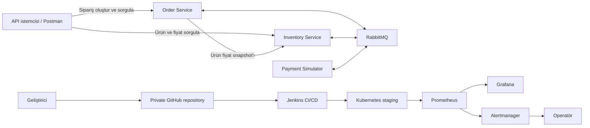

### 3.2 Aktör ve kullanım senaryosu görünümü

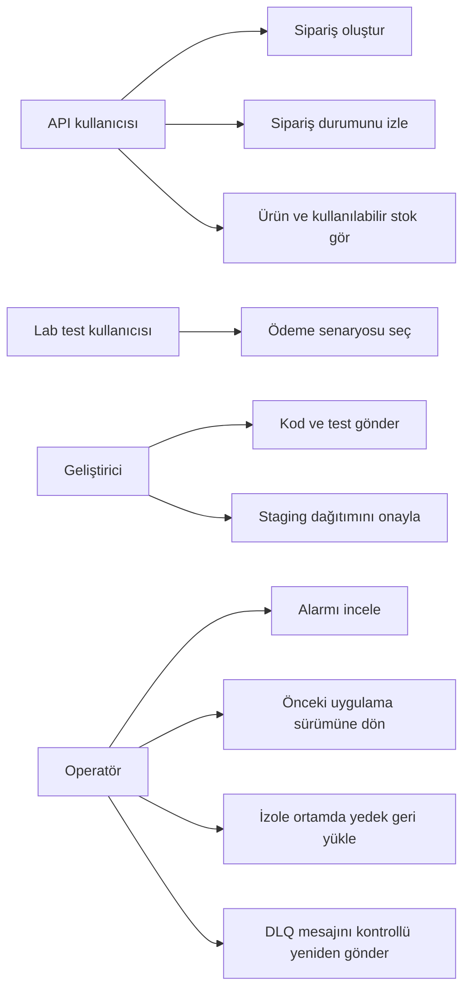

## 4. Servis sınırları ve bileşen modeli

| Servis | Sahip olduğu veri | İş sorumluluğu | Sahip olmadığı veri |
|---|---|---|---|
| Order | Orders, request idempotency, saga durumu, inbox/outbox | Sipariş sürecini koordine etme | Gerçek stok ve ödeme kayıtları |
| Inventory | Products, stock, reservations, inbox/outbox | Rezervasyon, stok doğruluğu, fiyat bilgisi | Sipariş veya ödeme tabloları |
| Payment | Payments, inbox/outbox | Ödeme sonucunu deterministik simüle etme | Stok veya sipariş tabloları |

### 4.1 Bileşen ve veri sahipliği

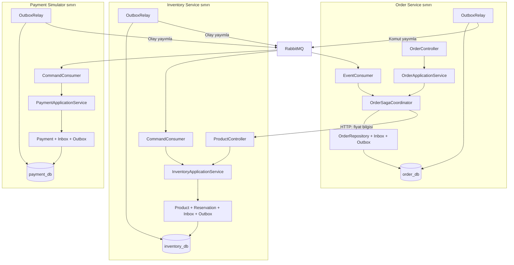

### 4.2 Bağımlılık yönü

Controller/consumer → application service → domain → repository port. Framework adaptörleri PostgreSQL ve RabbitMQ ile iletişim kurar. Bir servis başka servisin repository sınıfını veya entity'sini import etmez.

Mesaj sözleşmeleri `contracts/` içinde JSON Schema ve örnek JSON olarak tutulur. Ortak bir JPA entity veya ortak business service kütüphanesi kullanılmaz.

## 5. UML domain sınıf modeli

### 5.1 Order domain

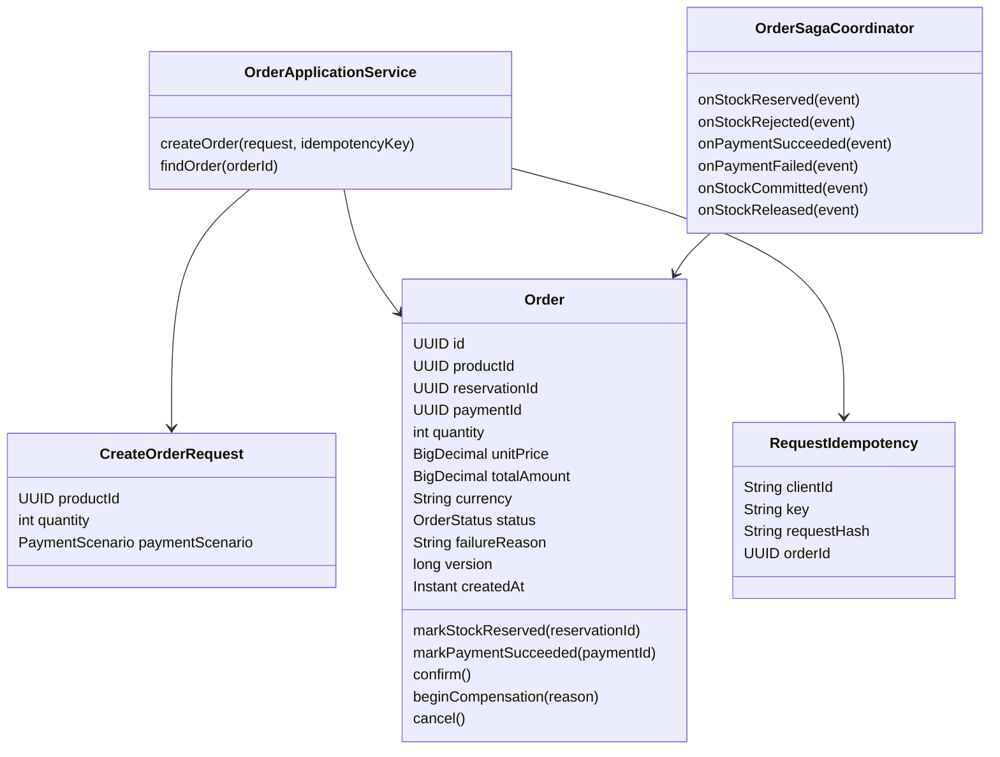

### 5.2 Inventory ve Payment domain

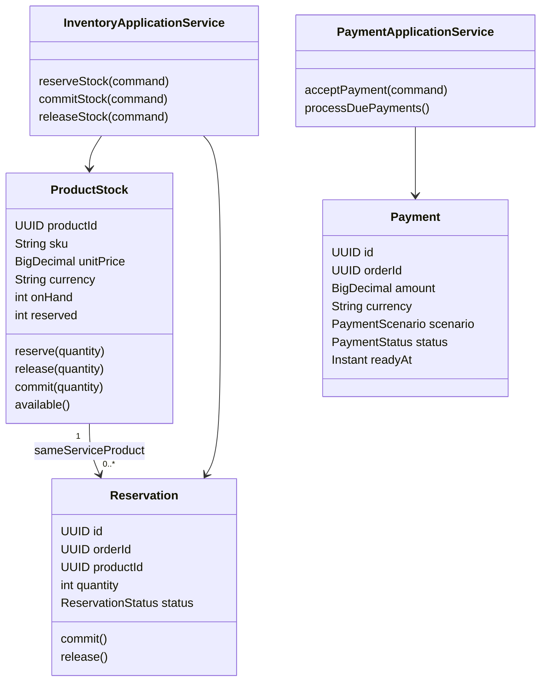

`orderId`, `reservationId` ve `paymentId` servisler arası referans kimlikleridir; başka veritabanına foreign key değildir.

## 6. Servis bazlı ER modelleri

### 6.1 Order veritabanı

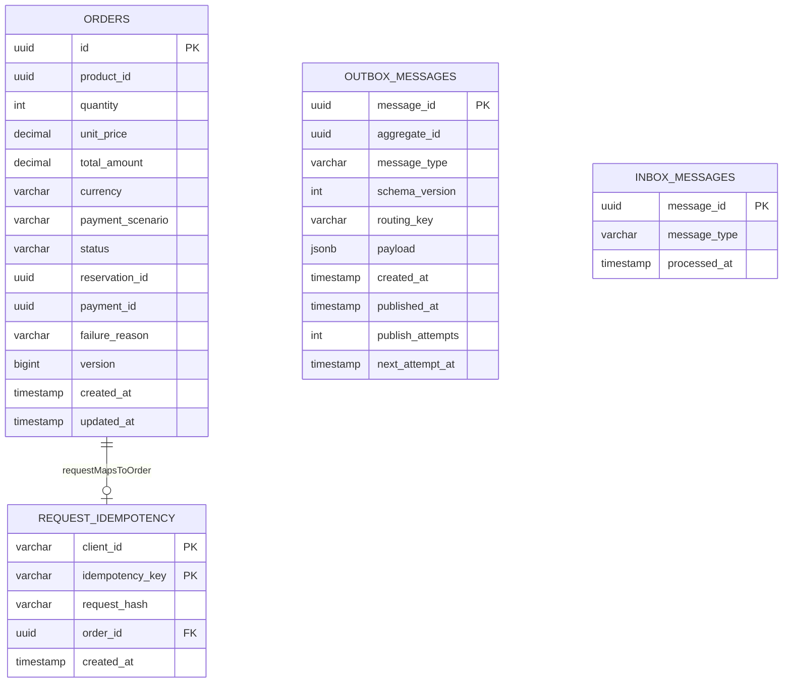

### 6.2 Inventory veritabanı

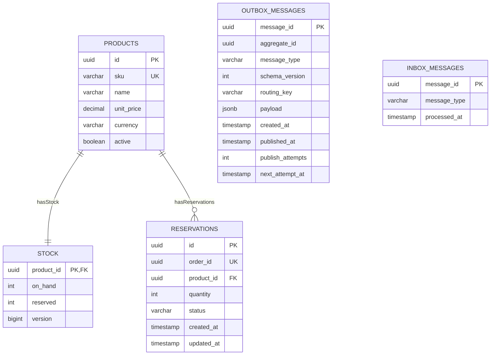

### 6.3 Payment veritabanı

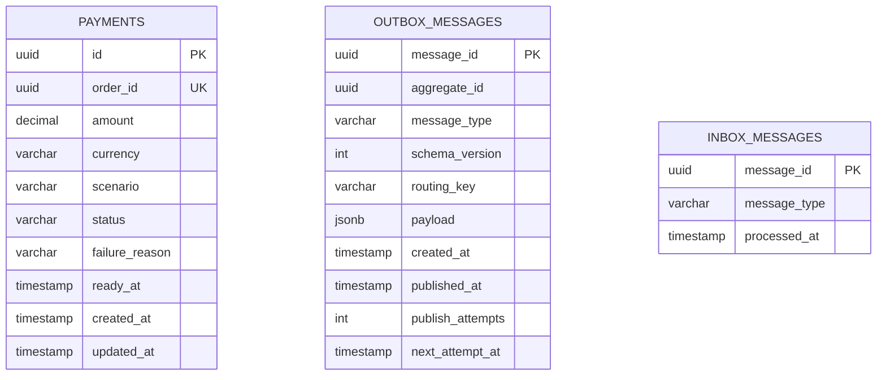

### Şema invariant'ları

- `quantity > 0`, fiyat/tutar negatif olamaz.
- `on_hand >= 0`, `reserved >= 0`, `reserved <= on_hand` DB check constraint'leriyle korunur.
- İlk sürümde `reservations.order_id` ve `payments.order_id` benzersizdir.
- HTTP idempotency benzersizliği `(client_id, idempotency_key)` üzerindedir.
- Her servisin inbox tablosunda `message_id` benzersizdir.
- Tablolar arasında servisler arası foreign key veya cross-database join yoktur.
- `outbox` için yayımlanmamış kayıtlar/yeniden deneme zamanı; `orders` için status/update zamanı; `payments` için pending/ready zamanı üzerinde indeksler bulunur.

## 7. Durum makineleri ve iş kuralları

### 7.1 Order saga

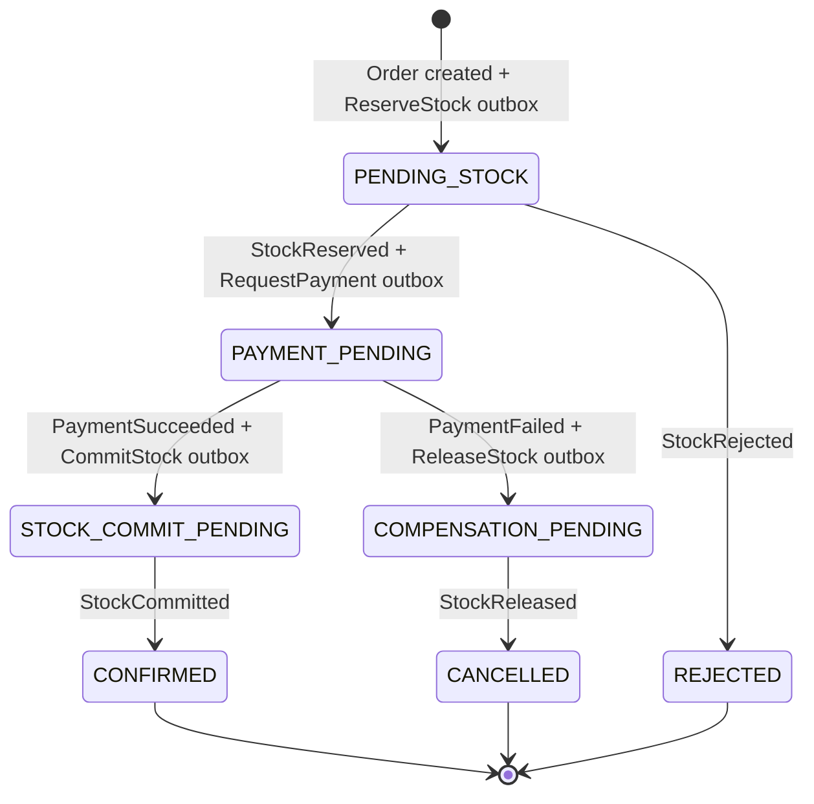

Sipariş, ödeme başarılı olduğu anda `CONFIRMED` sayılmaz; Inventory'den `StockCommitted` olayı da gelmelidir. `CANCELLED` için de `StockReleased` beklenir. DB transaction'ı içinde hem sipariş durum değişikliği hem sonraki komutun outbox kaydı yapılır.

Altyapı hatası business rejection değildir. RabbitMQ/DB kesintisi nedeniyle sipariş `REJECTED` yapılmaz; mevcut durumda kalır, işlem tekrar denenir ve uzun bekleme için alarm oluşur.

### 7.2 Reservation

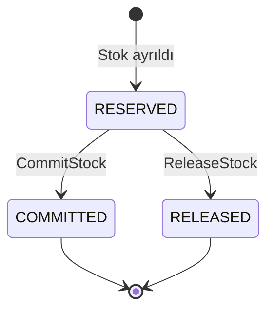

`COMMITTED` rezervasyon serbest bırakılamaz; `RELEASED` rezervasyon commit edilemez. Tekrar gelen aynı iş komutu stok değişikliğini ikinci kez yapmaz. Çelişkili komut sessizce kabul edilmez: domain conflict olarak kaydedilir ve operasyonel incelemeye gider.

### 7.3 Payment

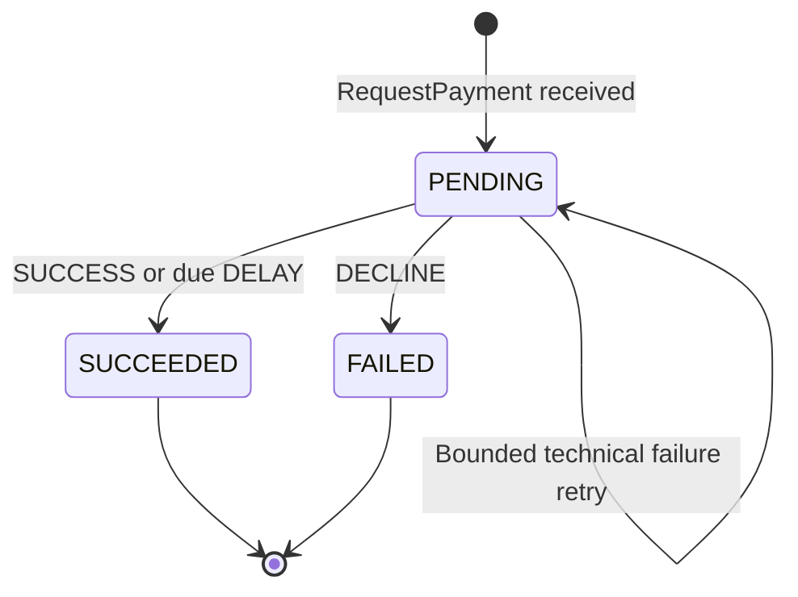

DELAY senaryosu consumer thread'ini uyutmaz; `ready_at` kaydedilir ve DB'deki bekleyen ödemeleri tarayan worker daha sonra sonucu üretir. Restart sonrası ödeme kaydı DB'de kaldığı için işlem devam eder.

### 7.4 Overselling'i engelleme

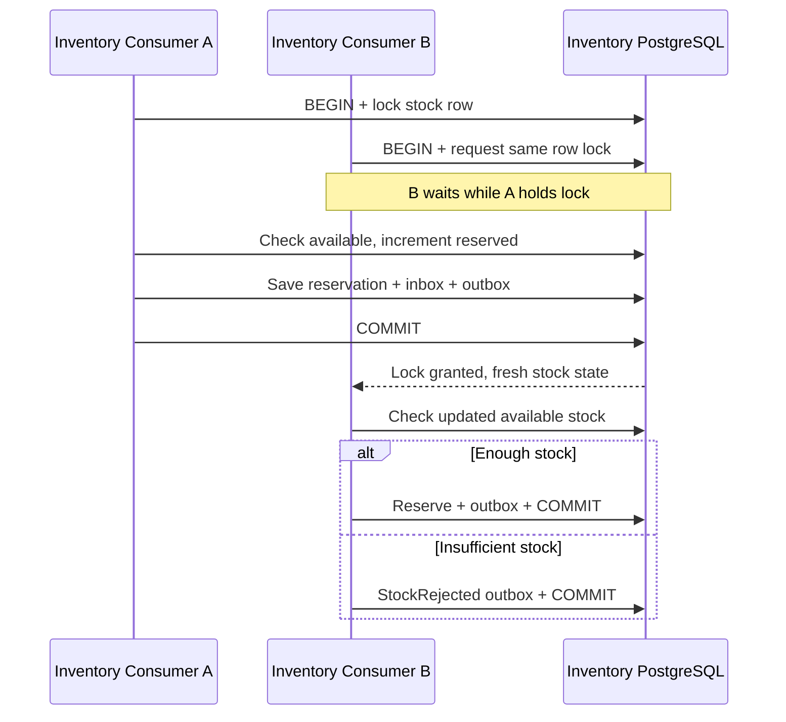

İlk sürüm PostgreSQL row lock kullanır. Bir rezervasyonda stok, reservation, inbox ve outbox aynı transaction'da güncellenir. Stok değişimleri:

- Reserve: `reserved += quantity`; `on_hand` değişmez.
- Commit: `on_hand -= quantity`, `reserved -= quantity`.
- Release: `reserved -= quantity`; `on_hand` değişmez.
- Available: `on_hand - reserved`.

Fiyat ilk sürüm seed edilmiş sabit katalog fiyatıdır; runtime fiyat güncelleme API'si yoktur. Çok ürünlü rezervasyona geçilirse tutarlı lock sırası ayrıca tasarlanmalıdır.

## 8. Mesaj sözleşmeleri ve güvenilir teslimat

### 8.1 Mesaj envelope

```json
{
  "messageId": "uuid",
  "messageType": "ReserveStock",
  "schemaVersion": 1,
  "occurredAt": "2026-10-12T10:00:00Z",
  "correlationId": "order-uuid",
  "causationId": "previous-message-uuid-or-null",
  "aggregateId": "order-uuid",
  "payload": {
    "orderId": "uuid",
    "productId": "uuid",
    "quantity": 1
  }
}
```

Bu JSON şema örneğidir; `uuid` değerleri gerçek çağrıda geçerli UUID olmalıdır. `messageId` outbox kaydıyla bir kere oluşturulur; relay yeniden yayımlarken aynı kimliği korur.

### 8.2 Komut ve olay kataloğu

| Mesaj | Üreten → tüketen | Payload özeti | Routing key |
|---|---|---|---|
| ReserveStock | Order → Inventory | orderId, productId, quantity | inventory.reserve.v1 |
| StockReserved | Inventory → Order | orderId, reservationId, quantity | inventory.reserved.v1 |
| StockRejected | Inventory → Order | orderId, reason | inventory.rejected.v1 |
| RequestPayment | Order → Payment | orderId, amount, currency, scenario | payment.request.v1 |
| PaymentSucceeded | Payment → Order | orderId, paymentId | payment.succeeded.v1 |
| PaymentFailed | Payment → Order | orderId, paymentId, reason | payment.failed.v1 |
| CommitStock | Order → Inventory | orderId, reservationId | inventory.commit.v1 |
| StockCommitted | Inventory → Order | orderId, reservationId | inventory.committed.v1 |
| ReleaseStock | Order → Inventory | orderId, reservationId | inventory.release.v1 |
| StockReleased | Inventory → Order | orderId, reservationId | inventory.released.v1 |

### 8.3 RabbitMQ topolojisi

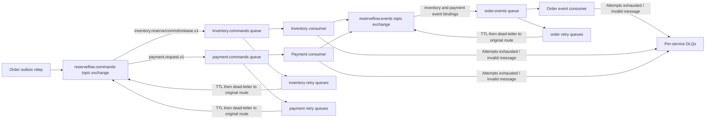

Exchange ve queue'lar durable, mesajlar persistent olacaktır. Tek broker labda quorum/high availability iddiası yoktur. Broker restart için kalıcı volume kullanılacaktır.

### 8.4 Transactional outbox / inbox kuralları

1. Business state + outbox aynı PostgreSQL transaction'ında yazılır.
2. Relay yayımlanmamış outbox kayıtlarını alır; publisher confirm ve unroutable return sonucunu kontrol eder.
3. Mesaj confirm edildikten sonra `published_at` işaretlenir. Confirm alınmazsa retry yapılır.
4. Consumer önce inbox benzersizliğini kontrol eder; yeni mesaj için inbox + business update + sonuç outbox tek transaction'dır.
5. Consumer broker ACK'ini **DB commit'ten sonra** verir.
6. Commit ile ACK arasında crash olursa broker tekrar teslim eder; inbox sayesinde ikinci business update yapılmaz.
7. Publisher confirm ile outbox işaretleme arasında crash olursa aynı messageId tekrar yayımlanabilir; consumer bunu deduplicate eder.

Hedef **at-least-once delivery + idempotent business processing**'dir. “Exactly once messaging” iddiası yoktur. Inbox tek başına yetmez; farklı messageId ile gelen aynı order işlemi için reservation/payment unique constraint ve domain durum kontrolü de kullanılır.

Birden çok replica olduğunda aynı aggregate'a gelen olaylar Order DB row lock/durum kontrolüyle sıraya alınır. Outbox batch sahipliği transaction içinde `FOR UPDATE SKIP LOCKED` ile modellenir; publish beklerken transaction süreleri sınırlandırılır. Kalıcı, gelişmiş relay lease mekanizması gerekirse ayrı ADR açılır.

### 8.5 Retry ve DLQ politikası

- Geçici DB veya network hatası: ilk deneme + **5, 15 ve 60 saniyelik en fazla üç retry**.
- Retry kuyruğuna publish için confirm alınmadan orijinal mesaj ACK edilmez. Publish başarısızsa consumer duraklatılır/backoff uygulanır; tight requeue döngüsü kullanılmaz.
- Geçersiz şema ve desteklenmeyen sürüm: doğrudan ilgili servis DLQ'su.
- Yetersiz stok ve ödeme reddi: retry değil, business event.
- Retry sırasında messageId/correlationId korunur; attempt bilgisi header'da tutulur.
- DLQ replay yalnız neden düzeltildikten sonra, aynı messageId korunarak ve audit kaydıyla yapılır.
- Geliştirme sürecinde DLQ forwarding ve broker restart davranışı entegrasyon testleriyle doğrulanır; durable queue/persistent mesaj tek başına kayıpsızlık garantisi değildir.

## 9. UML sequence diyagramları

### 9.1 Başarılı sipariş

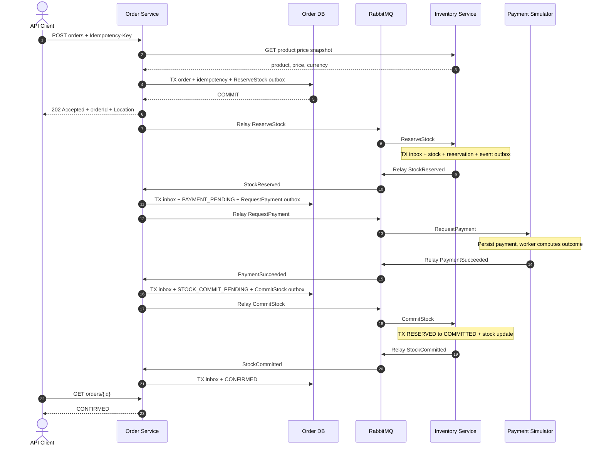

### 9.2 Ödeme reddi ve compensation

```mermaid
sequenceDiagram
    autonumber
    participant Order as Order Saga
    participant MQ as RabbitMQ
    participant Inventory as Inventory Service
    participant Payment as Payment Simulator
    Note over Order,Inventory: Stok zaten RESERVED durumda
    Order->>MQ: RequestPayment scenario DECLINE
    MQ->>Payment: RequestPayment
    Payment->>MQ: PaymentFailed
    MQ->>Order: PaymentFailed
    Note over Order: TX COMPENSATION_PENDING + ReleaseStock outbox
    Order->>MQ: ReleaseStock
    MQ->>Inventory: ReleaseStock
    Note over Inventory: TX RESERVED to RELEASED, reserved decreases
    Inventory->>MQ: StockReleased
    MQ->>Order: StockReleased
    Note over Order: CANCELLED; stock return acknowledged
```

### 9.3 DB commit sonrası consumer crash

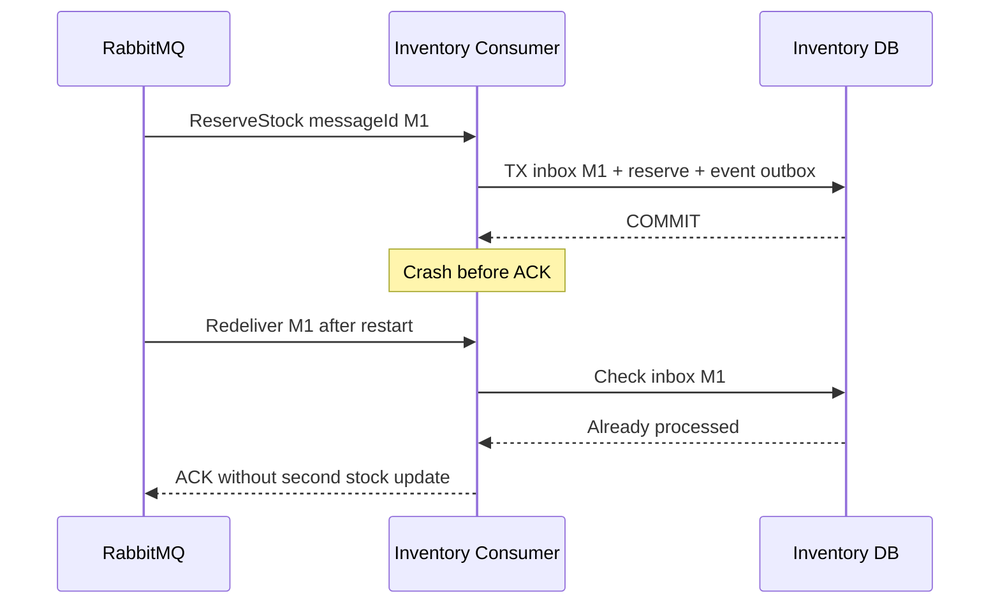

## 10. REST API sözleşmeleri

### API kapsamı

| Servis | Metot / endpoint | Amaç | Sonuç |
|---|---|---|---|
| Inventory | GET /api/v1/products | Seed ürünlerini listele | 200 |
| Inventory | GET /api/v1/products/{id} | Ürün/fiyat snapshot | 200 / 404 |
| Inventory | GET /api/v1/products/{id}/stock | onHand, reserved, available | 200 / 404 |
| Order | POST /api/v1/orders | Async sipariş oluştur | 202 |
| Order | GET /api/v1/orders/{id} | Saga durumunu sorgula | 200 / 404 |
| Payment | GET /internal/payments/by-order/{id} | Lab teşhisi | 200 / 404; internal only |
| Her servis | GET /actuator/health/liveness | Process sağlık kontrolü | Internal |
| Her servis | GET /actuator/health/readiness | Trafik alabilirlik | Internal |
| Her servis | GET /actuator/prometheus | Metrik scrape | Internal |

**Planlanan sipariş isteği:**

```http
POST /api/v1/orders
Content-Type: application/json
Idempotency-Key: order-demo-001
X-Correlation-Id: demo-request-001
```

```json
{
  "productId": "11111111-1111-1111-1111-111111111111",
  "quantity": 1,
  "paymentScenario": "SUCCESS"
}
```

`paymentScenario` yalnız simulator/lab API'sinin özelliğidir. Tutar ve fiyat istemci tarafından belirlenemez.

```json
{
  "orderId": "22222222-2222-2222-2222-222222222222",
  "status": "PENDING_STOCK",
  "totalAmount": "1499.90",
  "currency": "TRY"
}
```

### HTTP idempotency ve hata davranışı

- Aynı client + key + aynı canonical request hash: aynı orderId ile 202; yeni sipariş yok.
- Aynı client + key + farklı payload: 409 Conflict.
- Eşzamanlı aynı key: DB unique constraint ile tek kazanan transaction; diğeri mevcut orderId'yi döner.
- Geçersiz quantity/schema: 400; olmayan veya aktif olmayan ürün: 404/422.
- Inventory fiyat API'si ulaşılamazsa: bounded timeout sonrası 503; sipariş kaydı oluşturulmaz.
- RabbitMQ kesik ama DB sağlıklıysa: order/outbox commit edilip 202 dönebilir; outbox daha sonra gönderilir.
- Idempotency kaydı ilk lab sürümünde temizlenmez. Saklama politikasını değiştirmek ayrı karardır.
- Hata gövdesi status, code, message ve correlationId taşır; secret veya stacktrace taşımaz.

## 11. DevOps ve deployment modeli

### 11.1 Hedef UML deployment görünümü

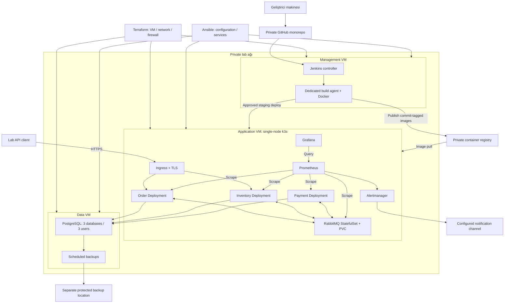

Bu üç VM fiziksel üretim izolasyonu değil, mantıksal lab ayrımıdır. Aynı host üzerinde çalıştırılması ortak hata alanı yaratır. Makine kaynakları yetmezse yönetim araçları ve monitoring sırayla çalıştırılabilir; ilk gün resource budget ölçülür.

### 11.2 Ağ/erişim modeli

| Kaynak | Port | İzin verilen kaynak |
|---|---:|---|
| SSH | 22 | Geliştirici/yönetim ağı |
| Ingress HTTPS | 443 | Lab istemcileri |
| Jenkins UI | 8080 veya TLS reverse proxy | Yönetim ağı; public açık değil |
| Kubernetes API | 6443 | Operatör ve staging deploy agent |
| PostgreSQL | 5432 | Uygulama ağı ve yetkili backup/restore işlemi |
| RabbitMQ AMQP | 5672 | Servis pod'ları |
| RabbitMQ UI/metrics | Yapılandırılmış yönetim portları | Yönetim ağı / Prometheus |
| Grafana / Prometheus | 3000 / 9090 | Yönetim ağı veya port-forward |

Geliştirmede Order/Inventory API'leri localhost'a yayınlanır. Payment, DB, broker, monitoring ve actuator endpointleri internete açılmaz. Staging'de NetworkPolicy destekli ortamda default-deny ve gerekli trafik için allow kuralları uygulanır.

### 11.3 Kubernetes çalışma kararları

- Başlangıçta her servis bir replica. Idempotency/concurrency testleri geçince Order/Inventory iki replica denemesi.
- Startup, readiness ve liveness ayrı düşünülür. PostgreSQL/RabbitMQ kesintisi liveness restart döngüsü başlatmamalıdır.
- Readiness servis özelindedir: broker kapalıyken Order DB/outbox ile sipariş kabul edebilir. Broker durumunu readiness'e kör biçimde bağlamayız.
- CPU/memory requests/limits ölçümden sonra belirlenir; kopyalanmış rastgele değerler kullanılmaz.
- RabbitMQ için PVC; tek node local storage node kaybına dayanıklı değildir.
- ConfigMap hassas olmayan ayarlar, Secret hassas bilgiler içindir. Base64 şifreleme değildir.
- Rolling update için önce backward-compatible migration. Yeni schema eski uygulama sürümünü kırmamalıdır.
- İlk sürümde raw Kubernetes manifestleri. Çalışan manifestlerden Helm chart çıkarılması son hafta hedefidir.

## 12. Jenkins pipeline modeli

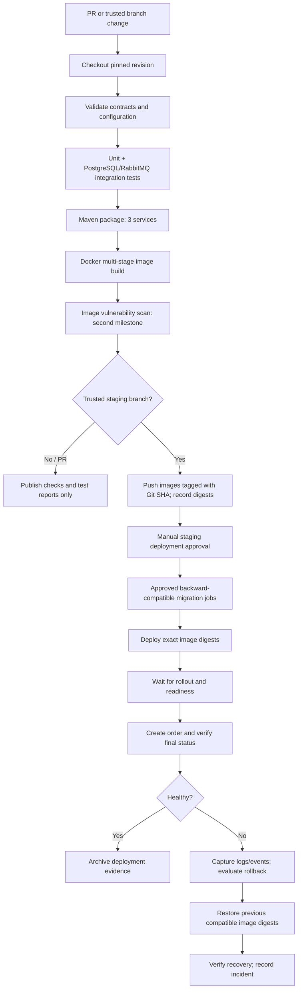

- PR build'leri deployment/registry secrets almadan test/build yapar. Secret erişimi olan agent üzerinde keyfi PR kodu çalıştırılmaz.
- Jenkins controller build çalıştırmaz; lab agent ayrı tanımlanır. Docker yetkisi olan agent yüksek yetkilidir ve yalnız güvenilir kod için kullanılır.
- Pipeline fail olduğunda sonraki publish/deploy aşamaları çalışmaz.
- Registry credential, SSH credential ve kubeconfig Jenkins credential store'da tutulur.
- Deploy kimliği yalnız staging namespace'inde gereken yetkilere sahiptir; genel cluster-admin verilmez.
- Branch/image tag tek başına yeterli değildir; deploy edilen image digest ve Git SHA kayıt altına alınır.
- DB migration rollback ile otomatik geri alınmaz. Image rollback, yalnız schema uyumu doğrulanınca uygulanır.
- Smoke test ayrı test ürün/client kimliği kullanır; gerçek veya mevcut demo kayıtlarını silmez.

## 13. Monitoring ve operasyon

### 13.1 Monitoring veri akışı

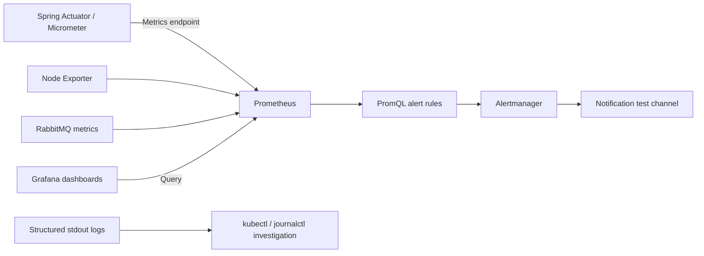

Monitoring bu projede yeni öğrenme modülüdür. İlk olarak uygulama/sunucu metrikleri, sonra PromQL, dashboard ve alarm kuralları yazılır. Merkezi log için Loki ve distributed tracing ilk ayın zorunlu kapsamına alınmaz.

### 13.2 Dashboard panelleri

| Dashboard | Paneller |
|---|---|
| Host | CPU, RAM, disk boşluğu, node erişilebilirliği |
| HTTP | İstek hızı, 5xx oranı, endpoint şablonu bazlı p95 latency |
| JVM | Heap, GC, thread ve DB connection pool |
| Messaging | Queue depth, consumer count, unacked, DLQ sayısı |
| Reliability | Yayımlanmamış outbox, en eski outbox yaşı, bekleyen saga yaşı |
| Business | CONFIRMED/REJECTED/CANCELLED sonuçları, stok/ödeme hata nedenleri |

OrderId/messageId metrik label'ı yapılmaz; yüksek cardinality yaratır. Bunlar correlationId ile loglarda tutulur. Latency histogram bucket'ları beklenen aralığa göre ayarlanır. DB'deki current pending/outbox değerleri gauge, gerçekleşen işlem sayıları counter olarak modellenir.

### 13.3 İlk alarm kuralları

Eşikler başlangıç lab değerleridir; load test sonucuna göre revize edilir.

| Alarm | Başlangıç koşulu | Beklenen ilk işlem |
|---|---|---|
| ServiceUnavailable | Target 1 dakika boyunca erişilemiyor | Pod/process ve network incele |
| HighHttpErrorRate | Yeterli trafik varken 5xx > %5, 5 dakika | Son deploy, log ve DB kontrolü |
| StaleOutbox | En eski unpublished kayıt > 2 dakika | Relay/broker bağlantısı ve routing kontrolü |
| StuckOrderSaga | Terminal olmayan saga > 3 dakika | İlgili queue, inbox/outbox ve ödeme worker'ı |
| DeadLetterMessages | DLQ'da mesaj var | Payload şeması, retry geçmişi, kalıcı hata |
| LowDiskSpace | Disk boşluğu < %15, 5 dakika | Log/volume/backup kullanımını incele |

Her alarm için `docs/runbooks/` altında belirti, komutlar, teşhis, kurtarma ve doğrulama adımları yazılır. Alarmın gerçekten tetiklendiği ve recovery bildiriminin geldiği kontrollü tatbikatla gösterilir.

### 13.4 Backup / restore

- PostgreSQL servis veritabanları için zamanlanmış backup ve retention politikası.
- Backup ayrı korunan konuma aktarılır; source VM diskinde tek kopya yeterli değildir.
- Restore önce ayrı test DB'lerinde yapılır; kayıt sayısı ve domain invariant'ları doğrulanır.
- Bağımsız servis DB yedekleri otomatik global-consistent snapshot sağlamaz. Tüm sistem restore tatbikatında giriş/consumer/relay durdurularak kontrollü quiescent lab backup alınır; broker/outbox/inbox tutarlılığı birlikte değerlendirilir.
- Backup sıklığı ve restore süresi ölçülerek RPO/RTO raporlanır; önceden gerçek dışı hedef sayıları yazılmaz.

## 14. Güvenlik ve yapılandırma

- Private repository'de de secret, token, private key, kubeconfig ve `.tfstate` commit edilmez.
- Her servise kendi DB credential'ı ve yalnız gereken broker izinleri verilir.
- Lab API erişimi trusted local/private ağla sınırlanır. İnternete açılacaksa kimlik doğrulama ve kullanıcı bazlı yetkilendirme ayrıca geliştirilir; yalnız TLS yeterli değildir.
- Product/Order kimlikleri başka kullanıcının verisini koruyan yetkilendirme değildir. İlk sürüm müşteri kimliği taşımayan private lab API'sidir.
- Uygulama image'ları non-root çalışır; secret'lar loglanmaz.
- Terraform state kaynakları/hassas veriler içerebilir; backend erişimi ve yedekleme korunur.
- HTTPS certificate doğrulaması dağıtım scriptlerinde kapatılmaz.
- Actuator için yalnız gerekli endpointler açılır; scrape erişimi sınırlandırılır.
- Dependency/image taraması ikinci milestone'da eklenir; Trivy sürümü ve severity politikası ADR'de sabitlenir.
- Varsayılan demo broker/DB parolaları staging'e taşınmaz.

## 15. Repository yapısı

Mevcut yapı aşağıdadır. Her serviste kendi `pom.xml`, `src/`, `Dockerfile` ve `.dockerignore` dosyası bulunur. Kökteki Compose dosyası her image'ı kendi servis dizininden build eder. Mevcut PostgreSQL servis/volume adı korunmuştur; bu taşıma veritabanını silmez veya yeniden oluşturmaz.

```text
reserveflow/
├── pom.xml
├── mvnw / mvnw.cmd / .mvn/
├── compose.yaml
├── README.md
├── services/
│   ├── inventory-service/
│   ├── order-service/
│   └── payment-service/
└── docs/adr/
```

Aşağıdaki genişletilmiş ağaç ise hedef yapıdır; contracts, infra, deploy, ci, monitoring ve tests dizinleri henüz uygulanmış değildir.

```text
reserveflow/
├── README.md
├── services/
│   ├── order-service/
│   ├── inventory-service/
│   └── payment-service/
├── contracts/
│   ├── commands/
│   ├── events/
│   ├── schemas/
│   └── examples/
├── infra/
│   ├── terraform/
│   │   ├── modules/
│   │   └── environments/lab/
│   └── ansible/
│       ├── inventories/
│       ├── roles/
│       └── playbooks/
├── deploy/
│   ├── compose/
│   ├── kubernetes/base/
│   ├── kubernetes/staging/
│   └── helm/
├── ci/
│   └── Jenkinsfile
├── monitoring/
│   ├── prometheus/
│   ├── grafana/dashboards/
│   └── alertmanager/
├── tests/
│   ├── contracts/
│   ├── e2e/
│   ├── concurrency/
│   └── failure-scenarios/
└── docs/
    ├── architecture/
    ├── adr/
    ├── runbooks/
    └── evidence/
```

Her servis için hedef paket ayrımı:

```text
api/                 HTTP endpoint ve request/response
application/         Use case ve saga koordinasyonu
domain/              Entity, enum ve iş kuralları
infrastructure/      JPA, AMQP, inbox/outbox, configuration
```

### Çalıştırma belgeleri

Güncel Maven ve Compose komutları README'nin başındaki mevcut durum bölümündedir. Inventory'nin PostgreSQL bağlantısı ve iş akışları doğrulandı. Üç servis dizini ve kök Maven aggregator eklendi. Servisler arası iletişim, Order/Payment veri katmanları ve production deployment henüz yoktur. Altyapı aşamalarına gelindikçe aşağıdaki başlıklar genişletilecektir:

1. Gereksinimler ve sabitlenmiş sürümler.
2. `.env.example` alanları ve yerel secret hazırlığı.
3. Compose ile geliştirme ortamı.
4. Testlerin çalıştırılması.
5. Terraform/Ansible ile lab kurulumu.
6. Jenkins credential ve pipeline kurulumu.
7. Kubernetes deployment ve smoke test.
8. Monitoring erişimi ve alarm denemesi.
9. Kaynak temizleme; yalnız lab kaynaklarını hedefleyen destroy prosedürü.

## 16. Test ve hata tatbikatları

| ID | Senaryo | Kabul ölçütü |
|---|---|---|
| T01 | Başarılı sipariş | CONFIRMED, payment SUCCEEDED, reservation COMMITTED |
| T02 | Ödeme reddi | CANCELLED, stok rezervasyonu sıfırlanmış, onHand korunmuş |
| T03 | Yetersiz stok | REJECTED; payment kaydı yok |
| T04 | 5 stok / 20 eşzamanlı başarılı ödeme siparişi | Tam 5 CONFIRMED, 15 REJECTED; negatif stok yok |
| T05 | Aynı HTTP idempotency key ile eşzamanlı istek | Tek order kaydı ve aynı orderId |
| T06 | Aynı key, farklı payload | 409, yeni order yok |
| T07 | Aynı mesaj iki kez | Tek business state değişikliği |
| T08 | Consumer DB commit sonrası ACK öncesi crash | Restart sonrası çift stok/ödeme yok |
| T09 | Publisher confirm sonrası outbox işaretleme öncesi crash | Tekrar teslim güvenli biçimde deduplicate |
| T10 | RabbitMQ geçici kesinti | Outbox DB'de korunur; bağlantı gelince süreç ilerler |
| T11 | Payment DELAY sırasında restart | Pending payment DB'den devam eder |
| T12 | Kalıcı teknik consumer hatası | Sınırlı retry sonunda DLQ; sonsuz requeue yok |
| T13 | Geçersiz mesaj şeması | Business değişikliği yok; DLQ ve alarm |
| T14 | Ansible ikinci çalıştırma | Amaçlanan steady state'te gereksiz değişiklik yok |
| T15 | Hatalı unit/integration test | Jenkins publish/deploy aşamasına geçmez |
| T16 | Yanlış image veya sağlık kontrolü | Rollout başarısızlığı teşhis edilir; uyumlu önceki image'a dönüş doğrulanır |
| T17 | Pod silme | Yeni Pod sağlıklı açılır; demo sipariş durumu korunur |
| T18 | PostgreSQL bağlantı kesintisi | Uygun API hatası; yanlış CONFIRMED/REJECTED sonucu yok |
| T19 | Monitoring target kesintisi | Alarm ve recovery bildirimi kayıtlı |
| T20 | İzole PostgreSQL restore | Kayıt ve invariant doğrulaması; ölçülmüş restore süresi |

Mock tabanlı unit testler domain kurallarını sınar. PostgreSQL lock, unique constraint, Flyway ve RabbitMQ davranışları Testcontainers ile gerçek bileşenlerde sınanır. Crash-window testleri deterministik test hook veya kontrollü fault injection kullanır; yalnız rastgele container kill sonucuna güvenilmez.

Failure testleri sadece lab/test verisine uygulanır. Her koşu için timestamp, Git SHA, ortam, beklenen/gerçek sonuç ve temizleme adımı kaydedilir.

## 17. 30 günlük uygulama planı

**Plan bir teslim garantisi değildir.** Öğrenerek elle yazma temposunda öncelik çalışan temel akış ve doğrulamadır. İlk dört hafta sonunda v0.1; kalan güvenilirlik/operasyon modülleri eksikse açıkça backlog'a alınır. Tüm ileri konuları yetiştirmek için test veya açıklama aşamaları atlanmaz.

| Gün | Senin yazacağın/uygulayacağın iş | Gün sonu çıktısı |
|---|---|---|
| 1 | Domain kuralları, provider/VM kaynak bütçesi, ADR-001 | Tasarım kararları ve ilk repo |
| 2 | Üç servis scaffold ve dependency sürümleri | Bağımsız build edilen servisler |
| 3 | PostgreSQL DB/user ayrımı ve Flyway | Üç migration seti |
| 4 | Product/stock ve seed | Çalışan product/stock API |
| 5 | Row lock ile reservation | Overselling unit/integration testleri |
| 6 | Order API, fiyat snapshot, HTTP idempotency | Tekrarlı istek testi |
| 7 | Payment simulator ve state modeli | SUCCESS/DECLINE/DELAY testleri |
| 8 | Mesaj schema/envelope ve broker topology | Sözleşme testleri |
| 9 | ReserveStock / StockReserved / StockRejected | Async stok akışı |
| 10 | Payment komutu ve sonucu | Ödeme sonucu siparişe geliyor |
| 11 | Commit/release ve saga state transitions | Success + compensation uçtan uca |
| 12 | Outbox relay ve publisher confirm | Kesintide DB'de kalan mesajlar |
| 13 | Inbox ve domain deduplication | Duplicate mesaj testi |
| 14 | Sınırlı retry, DLQ, 20 eşzamanlı sipariş | T04/T07/T12 kanıtları |
| 15 | Dockerfile ve Compose | Temiz ortamda üç servis |
| 16 | Jenkins test/build hattı | Test raporu üreten pipeline |
| 17 | Registry push ve SHA/digest kaydı | Versiyonlu image'lar |
| 18 | Terraform seçilen provider lab kaynakları | Plan/apply ve kaynak envanteri |
| 19 | Ansible Linux yapılandırması | Tekrarlanabilir kurulum |
| 20 | k3s, namespace, Service ve config | İlk Kubernetes deployment |
| 21 | Probes, limits, erişim politikaları | Sağlıklı rollout ve ağ tablosu |
| 22 | Jenkins staging deploy ve smoke | Otomatik doğrulanan dağıtım |
| 23 | Monitoring temelleri, exporter/metrics | Prometheus scrape |
| 24 | PromQL ve Grafana panelleri | Uygulama/sunucu dashboard |
| 25 | Alertmanager ve controlled failure | Alarm + recovery kanıtı |
| 26 | Rollback ve backward-compatible migration tatbikatı | Runbook ve incident kaydı |
| 27 | Backup/izole restore | Ölçülmüş restore raporu |
| 28 | Crash/restart ve broker kesintisi testleri | Reliability sonuç tablosu |
| 29 | Kaynak bütçesi uygunsa Helm ve image scan | Chart/tarama raporu veya açık backlog |
| 30 | Diyagramları gerçekle eşleştir, temiz kurulum, demo | v0.1 ve CV kanıt paketi |

Gün 14 sonunda iş akışı doğrulanmadıysa sonraki DevOps günleri kaydırılır. Gün 22 sonunda rollout/smoke çalışmıyorsa monitoring öncesi bu sorun çözülür. Helm, Trivy ve ileri crash testlerinin tamamı ilk aya sığmayabilir; başarı durumu yalnız gerçek test sonuçlarına göre işaretlenir.

### Geliştirme çalışma biçimi

Kod ve altyapı dosyaları öğrenci tarafından elle yazılır. Yardım; mimari gerekçeleri açıklama, küçük görevler verme, code review ve hata çıktısını yorumlama şeklindedir. Hazır bir sistemi açıklayamadan teslim etmek projenin eğitim hedefi değildir.

Her milestone sonunda şu sorular cevaplanır: “Hangi problemi çözdüm?”, “Bu teknolojiyi neden kullandım?”, “Hangi hata durumunu denedim?”, “Sonuç nerede kayıtlı?”

## 18. Tamamlanma ölçütleri ve CV kanıtları

### Milestone durumları

| Milestone | Durum |
|---|---|
| M0: README ve hedef mimari | Tasarım belgesi hazır |
| M1: Üç servis ve bağımsız veri sahipliği | Planlandı |
| M2: Saga, stok doğruluğu ve mesaj güvenilirliği | Planlandı |
| M3: Docker/Compose ve Jenkins CI | Planlandı |
| M4: Terraform/Ansible ve Kubernetes staging CD | Planlandı |
| M5: Monitoring, rollback ve restore | Planlandı |
| M6: Demo, kaynak eşleştirmesi ve kanıt paketi | Planlandı |

### Tamamlanmış proje için kabul ölçütleri

- Temiz bir ortamda belgelenmiş kurulumla sistem çalışır.
- Success, stock rejection ve payment compensation akışları geçer.
- Eşzamanlı sipariş testi stok invariant'larını korur.
- Duplicate/crash teslimatı ikinci business işlem oluşturmaz.
- Jenkins testi başarısız kodu dağıtmaz; deploy SHA/digest kaydı vardır.
- Terraform ve Ansible gerçek seçilen ortamda uygulanmış, ikinci çalışma gözlemlenmiştir.
- Kubernetes update ve rollback; alarm ve restore denemesi kayıtlıdır.
- UML/ER/state diyagramları uygulanan yapıyla eşleşir.
- Henüz yapılmayan özellikler README'de plan olarak kalır.

### Kanıt klasörü standardı

Her `docs/evidence/` kaydı şu alanları içerir:

```text
Tarih / Git SHA / Milestone
Ortam ve sürümler
Deneyin amacı
Çalıştırılan komut veya test
Beklenen sonuç
Gerçek sonuç ve ölçüm
İlgili pipeline/test raporu
Temizleme ve bilinen sınırlamalar
```

Secret içermeyen test raporu, pipeline kaydı, dashboard JSON, alarm kuralı, migration, runbook ve kısa demo kullanılır. Private repo görüşmeci tarafından açılamıyorsa izinli erişim veya secret içermeyen ayrı mimari/demo özeti sunulur.

### Tamamlandıktan sonra kullanılabilecek CV maddeleri

Bu maddeler şu an hedef ifadeleridir; ilgili milestone ve kanıt tamamlanmadan mevcut başarı olarak sunulmaz.

- Developed a three-service order reservation system with service-owned PostgreSQL databases and RabbitMQ-based saga orchestration.
- Implemented transactional outbox, inbox deduplication and bounded retries; verified stock correctness under concurrent orders and message redelivery.
- Built a Jenkins pipeline for automated tests, container image publication and approved Kubernetes staging deployments.
- Provisioned lab infrastructure with Terraform and configured Linux hosts with Ansible.
- Implemented Prometheus/Grafana monitoring and validated alerting, deployment rollback and database restore procedures.

Performans, uptime veya deployment süresi kazanımı yalnız ölçülmüş sonuç varsa eklenir. Tek node lab “production-grade highly available platform” olarak adlandırılmaz.

## 19. Mimari karar kayıtları

| ADR | Karar | Durum |
|---|---|---|
| ADR-001 | Tek monorepo, üç bağımsız deploy edilen servis | Tasarım kararı |
| ADR-002 | Üç servis-owned DB, labda ortak PostgreSQL host | Tasarım kararı |
| ADR-003 | Order-orchestrated saga; tek ürünlü sipariş | Tasarım kararı |
| ADR-004 | At-least-once + outbox/inbox; exactly-once iddiası yok | Tasarım kararı |
| ADR-005 | Stok rezervasyonunda PostgreSQL row lock | Tasarım kararı |
| ADR-006 | Terraform provider, kaynak bütçesi ve registry seçimi | İlk gün seçilecek |
| ADR-007 | Tek node k3s staging; HA kapsam dışında | Tasarım kararı |
| ADR-008 | Jenkins deploy; Argo CD ilk sürüm dışında | Tasarım kararı |
| ADR-009 | Timeout/TTL yerine bounded simulator ve stuck-saga alarmı | Tasarım kararı |
| ADR-010 | Probes, migration/rollback uyumu ve restore prosedürü | Uygulamada doğrulanacak |

ADR belgelerinde context, seçenekler, seçilen çözüm, sonuçlar ve doğrulama bulunur. Tasarım değişirse README ve ilgili diyagram aynı PR'da güncellenir.

---

**Sonraki adım:** Inventory repository arayüzleri ve stok rezervasyonu iş kuralları. Inventory Service scaffold ve model sınıfları hazırdır; diğer servisler ve altyapı henüz geliştirilmemiştir.
